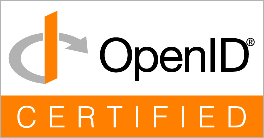
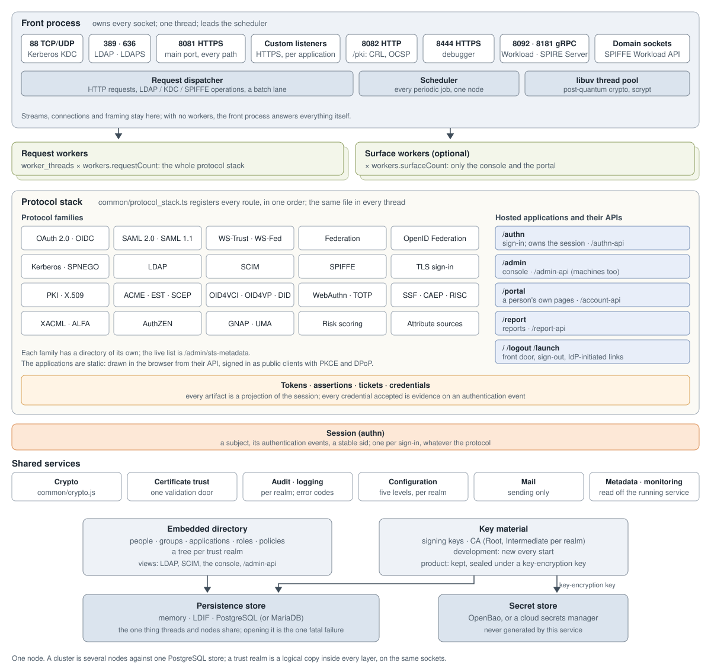

<p align="center"></p>

# iya-sts

An **identity provider and security token service** that speaks the protocol
families below from one process, with a certificate authority of its own.

It started as IYA STS inside the [OAuth2/OIDC Debugger](https://idptools.com)
project's test suite, and it runs in one of two modes, per trust realm
(`global.mode`):

* **`development`** (the default) is the permissive test mode: any username signs in, anything
  named is created, signing keys are regenerated on every start and test
  controls are open. Use it to exercise clients. **Never use it to protect
  anything.**
* **`product`** runs the same protocol implementations with the permissiveness
  taken out: passwords are verified against the directory, responses go only to
  registered addresses, there is no demonstration data, keys persist sealed
  under a key-encryption key, and several containers can share one PostgreSQL
  store.

`GET /admin/mode` says, for the running realm, exactly what each mode does.
Product mode is still being hardened; read the product-mode notes on a
protocol's documentation page before relying on it.

**The documentation is at [`docs/`](docs/index.md)** (published as a GitHub
Pages site): configuration, architecture, and a page per protocol family.

## iya-sts — Flexible, Secure Identity Integration for the AI Era

Identity infrastructure shouldn't become the bottleneck for the next generation of applications.

iya-sts is flexible, security-focused Identity Integration software designed to connect modern applications, services, workloads, and AI agents to the identity protocols and authorization systems they already use.

Built around open standards rather than a single identity ecosystem, iya-sts brings together authentication, federation, token services, authorization, delegation, and identity integration in one extensible platform.

From traditional enterprise applications to cloud workloads and emerging AI-agent architectures, iya-sts is designed for the messy reality of modern identity: multiple protocols, multiple trust domains, multiple identity types, and increasingly complex relationships between users, applications, services, and agents.

### Built for integration

iya-sts works across the identity landscape rather than forcing everything into one proprietary model. Its protocol-oriented architecture supports technologies including OAuth 2.0, OpenID Connect, SAML, WS-Trust, WS-Federation, Kerberos, SCIM, XACML, WebAuthn, and modern verifiable-credential and workload-identity technologies.

### Built for the AI era

AI systems introduce a new identity problem: software increasingly acts on behalf of people, applications, and other agents.

That requires more than simply authenticating a user.

It requires understanding who is acting, on whose behalf, what authority was delegated, what resources can be accessed, and how that authority can be constrained and enforced.

iya-sts provides an identity foundation for those relationships—bringing traditional enterprise identity concepts into architectures where humans, applications, workloads, and AI agents all participate.

### Standards first. Integration focused.

iya-sts is built around open identity and security standards, making it useful as an integration layer between systems that were never designed to speak the same identity language.

One identity layer. Multiple protocols. Multiple trust relationships. Modern applications and AI agents.

iya-sts is built for organizations that don't want to replace their entire identity infrastructure just to build what's next.

# OpenID Connect Certification
<p align="left"></p>

**Iya-STS v1.0.0**, from Iya CyberSecurity Solutions, has achieved OpenID Connect Provider (OP) certification through the OpenID Foundation across all seven published OP conformance profiles and all four OpenID Connect logout profiles.

## OpenID Connect Provider Conformance Profiles

| Conformance Profile | Certification Date |
|---|---|
| Basic OpenID Provider | November 5, 2026 |
| Implicit OpenID Provider | November 5, 2026 |
| Hybrid OpenID Provider | November 5, 2026 |
| Configuration | November 5, 2026 |
| Dynamic OpenID Provider | November 5, 2026 |
| Form Post Response Mode | November 5, 2026 |
| Third-Party Initiated Login | November 5, 2026 |

**Official registry:** [Certified OpenID Providers & Profiles](https://openid.net/certification/certified-openid-providers-profiles/)

## OpenID Connect Logout Profiles

| Logout Profile | Certification Date |
|---|---|
| RP-Initiated Logout | November 5, 2026 |
| Session Management | November 5, 2026 |
| Front-Channel Logout | November 5, 2026 |
| Back-Channel Logout | November 5, 2026 |

**Official registry:** [Certified OpenID Providers for Logout Profiles](https://openid.net/certification/certified-openid-providers-for-logout-profiles/)

## Certification Summary

Iya-STS v1.0.0 has achieved **11 OpenID Foundation certifications**:

- 7 OpenID Connect Provider conformance profiles
- 4 OpenID Connect Logout profiles

All eleven certifications are dated November 5, 2026, and are published in the OpenID Foundation's official certification registries.

These certifications demonstrate conformance of Iya-STS v1.0.0 with the applicable OpenID Connect Provider and Logout specifications and profiles.

For independent verification, refer to the official OpenID Foundation certification registries linked above.

## Architecture

[](docs/v1.2.0/architecture.svg)

One front process owns every listener, and a request dispatcher hands work to
two pools of worker threads (request and surface); one scheduler runs every
periodic job. The protocol families and the hosted applications share one
session model and one set of services over the embedded directory and the key
material. [`docs/v1.2.0/architecture.md`](docs/v1.2.0/architecture.md) walks through each
layer. Each source directory has a `CLAUDE.md` with the maintainer's notes for
the modules in it.

## Protocol families

| Family | Major specifications | What it is |
|---|---|---|
| [OAuth 2.0 / OpenID Connect](docs/v1.2.0/oauth-oidc.md) | RFC 6749, OIDC Core 1.0, RFC 8414, RFC 7636, RFC 8693, RFC 9101, RFC 9126, RFC 9396, RFC 9068, RFC 7662/9701 | A full authorization server and OpenID provider, with discovery, registration, logout and CIBA. |
| [OAuth security profiles](docs/v1.2.0/oauth-security.md) | RFC 9700, OAuth 2.1, RFC 9449 (DPoP), RFC 8705 (mTLS), RFC 9470, FAPI 1.0 / 2.0, JARM | Switchable compliance modes and sender-constrained tokens. |
| [Assertion grants](docs/v1.2.0/jwt-assertions.md) | RFC 7521, RFC 7523, RFC 7522 | JWT and SAML assertions as client credentials and as authorization grants. |
| [SAML 2.0](docs/v1.2.0/saml2-sso.md) | SAML 2.0 Core, Bindings, Profiles, Metadata | Web Browser SSO over Redirect, POST, SimpleSign and Artifact, with Single Logout. |
| [SAML 1.1](docs/v1.2.0/saml11.md) | SAML 1.1 | Browser/POST and Browser/Artifact profiles and an attribute authority. |
| [WS-Trust](docs/v1.2.0/ws-trust.md) | WS-Trust 1.0–1.4, WS-Security | A SOAP security token service: issue, renew, validate, cancel. |
| [WS-Federation](docs/v1.2.0/ws-federation.md) | WS-Federation 1.2 | The passive requestor profile, with federation metadata. |
| [Federation](docs/v1.2.0/federation.md) | SAML 2.0, SAML 1.1, WS-Fed, OIDC, OAuth 2.0 | Either end of a configured relationship with a foreign identity provider. |
| [OpenID Federation](docs/v1.2.0/oidfed.md) | OpenID Federation 1.1 | Every realm a federation entity: trust chains, metadata policy, trust marks. |
| [GNAP](docs/v1.2.0/gnap.md) | RFC 9635, RFC 9767, RFC 9421 | A key-proofed grant negotiation server issuing tokens in five formats. |
| [Kerberos and SPNEGO](docs/v1.2.0/kerberos.md) | RFC 4120, RFC 4121, RFC 4178, RFC 4559, MS-KKDCP, MS-SFU | A KDC on TCP/UDP 88, a Kerberized service, and SPNEGO sign-in over HTTP. |
| [LDAP](docs/v1.2.0/ldap.md) | RFC 4511 | The embedded directory on 389 and LDAPS 636 — the store for people, groups and applications. |
| [SCIM](docs/v1.2.0/scim.md) | RFC 7642, RFC 7643, RFC 7644 | Provisioning into that same directory. |
| [Authentication](docs/v1.2.0/authentication.md) | WebAuthn Level 3, CTAP 2.1, FIDO U2F, RFC 6238, [W3C Device Bound Session Credentials](docs/v1.2.0/sessions.md#binding-the-cookie-to-the-browser-device-bound-session-credentials) (draft) | Passwords, passkeys (including credProtect and imported U2F keys), recovery codes and emailed codes; a sign-on session bound to a key the browser holds. |
| [One-time code tokens](docs/v1.2.0/one-time-code-tokens.md) | RFC 4226 (HOTP), RFC 6030 (PSKC) | A counter-based second factor from a YubiKey HOTP slot or a vendor seed file. |
| [YubiKey OTP](docs/v1.2.0/yubiotp.md) | Yubico OTP, YK-VAL 2.0 | Local validation of a YubiKey OTP, and an optional YK-VAL 2.0 server. Nothing is sent to YubiCloud. |
| [Hardware tokens](docs/v1.2.0/hardware-tokens.md) | NIST SP 800-73-4, FIPS 201-3, YubiKey PIV attestation, WebAuthn enterprise attestation | A register of physical keys, PIV certificates from attested keys, and lost-token retirement. |
| [OpenPGP keys and encrypted mail](docs/v1.2.0/openpgp.md) | RFC 9580, RFC 4880, RFC 9980, RFC 3156, RFC 8551, RFC 9629, RFC 9935, OpenPGP Web Key Directory | A person's OpenPGP key, publication in the Web Key Directory, and mail encrypted to that key or to an S/MIME certificate, classical or post-quantum. |
| [TLS / mutual TLS](docs/v1.2.0/tls.md) | RFC 8446, RFC 5280 | Client certificates on the main port, and certificate sign-in. |
| [OpenID for Verifiable Credentials](docs/v1.2.0/oid4vci.md) | OpenID4VCI 1.0, OpenID4VP 1.0, SD-JWT VC, W3C DID Core, Token/Bitstring Status List | A credential issuer, a verifier, status lists and wallet sign-in. |
| [Shared Signals](docs/v1.2.0/shared-signals.md) | OpenID SSF 1.0, CAEP, RISC, RFC 8417, RFC 8935/8936 | A security event transmitter, and a receiver of its own. |
| [SPIFFE](docs/v1.2.0/spiffe.md) | SPIFFE, SPIRE Server API | Bundle endpoint, Workload API and SPIRE Server API per trust realm. |
| [XACML](docs/v1.2.0/xacml.md) | XACML 3.0, ALFA | A policy decision point that decides this service's own issuance and access. |
| [Certificate authority](docs/v1.2.0/pki.md) | RFC 5280, RFC 6960, RFC 8555, RFC 7030, RFC 8894, OpenSSH PROTOCOL.certkeys and PROTOCOL.krl | A Root, an Intermediate per realm, CRLs and OCSP, ACME, EST and SCEP enrollment, and an OpenSSH user CA per realm. |
| [Keys in a hardware security module](docs/v1.2.0/hsm.md) | PKCS #11 3.x, RFC 7512 | The key-encryption key, and a realm's classical signing keys, inside a PKCS #11 module. |
| [Mail](docs/v1.2.0/mail.md) | SMTP, DKIM | Outbound mail for password reset, verification and security notices. |

`GET /admin/sts-metadata` lists every endpoint from the running router, with the
coverage of each specification.

## Specifications

The table above names the major specifications of each family. This one names
every specification in the service's own table (`sts_metadata.ts`), grouped
for reading. Being listed is not a claim of full conformance: each entry
carries a coverage statement of `full`, `partial` or `minimal`, saying what is
missing, and `GET /admin/sts-metadata` on a running instance is where to read
it. Entries marked *draft* follow a document that may still change.

| Group | Specifications |
|---|---|
| OAuth 2.0 | RFC 6749, RFC 6750, RFC 7009, RFC 7521, RFC 7522, RFC 7523, RFC 7591, RFC 7592, RFC 7636, RFC 7662, RFC 7800, RFC 8176, RFC 8414, RFC 8628, RFC 8693, RFC 8705, RFC 8707, RFC 9068, RFC 9101, RFC 9126, RFC 9207, RFC 9396, RFC 9440, RFC 9449, RFC 9470, RFC 9700, RFC 9701, RFC 9728; BCP 47 (RFC 5646, RFC 4647); The OAuth 2.1 Authorization Framework (draft); OAuth 2.0 Attestation-Based Client Authentication (draft); OAuth 2.0 Multiple Response Type Encoding Practices; OAuth 2.0 Form Post Response Mode; JWT Secured Authorization Response Mode for OAuth 2.0 (JARM); Grant Management for OAuth 2.0 (draft) |
| OpenID Connect | OpenID Connect Core 1.0; OpenID Connect Discovery 1.0; OpenID Connect Dynamic Client Registration 1.0; OpenID Connect Session Management 1.0; OpenID Connect Front-Channel Logout 1.0; OpenID Connect Back-Channel Logout 1.0; OpenID Connect RP-Initiated Logout 1.0; OpenID Connect Client-Initiated Backchannel Authentication Flow — Core 1.0 (CIBA); OpenID Connect Native SSO for Mobile Apps 1.0; OpenID Connect Key Binding 1.0; OpenID Connect EAP ACR Values 1.0; OpenID Connect for Identity Assurance 1.0; OpenID Connect for Identity Assurance Claims Registration 1.0; OpenID Connect Claims Aggregation; OpenID Provider Commands 1.0 (draft); OpenID Connect Enterprise Extensions 1.0 (draft); OpenID Connect Ephemeral Subject Identifier (draft); WebFinger (RFC 7033) |
| FAPI | FAPI 1.0 Part 1: Baseline Security Profile; FAPI 1.0 Part 2: Advanced Security Profile; FAPI 2.0 Security Profile, with its Attacker Model; FAPI 2.0 Message Signing; FAPI 2.0 Http Signatures (draft); FAPI: Client Initiated Backchannel Authentication Profile |
| OpenID Federation | OpenID Federation 1.1; OpenID Federation for OpenID Connect 1.1; OpenID Federation Extended Subordinate Listing 1.0 (draft); OpenID Federation Entity Collection Endpoint 1.0 (draft); OpenID Federation Subordinate Events Endpoint 1.0 (draft) |
| JOSE, COSE and CWT | RFC 7515, RFC 7516, RFC 7517, RFC 7518, RFC 7519, RFC 8392, RFC 9052 |
| GNAP, UMA and capability tokens | RFC 9635, RFC 9767, RFC 9421, RFC 9530; User-Managed Access (UMA) 2.0 Grant for OAuth 2.0 Authorization; Federated Authorization for User-Managed Access (UMA) 2.0; Macaroons: Cookies with Contextual Caveats (NDSS 2014) and the libmacaroons V2 format; Biscuit authorization token specification; W3C CCG Authorization Capabilities for Linked Data (ZCAP-LD) v0.3 |
| Authorization | OASIS XACML 3.0 (core); JSON Profile of XACML 3.0 v1.1; ALFA for XACML Version 1.0 (draft); AuthZEN Authorization API 1.0; AuthZEN Access Request and Approval Profile 1.0 (draft); AuthZEN Callback Notifications Profile 1.0 (draft); AuthZEN Access Request Catalog Profile 1.0 (draft); AuthZEN Actor Delegation Profile 1.0 (draft); AuthZEN Bulk Access Requests Profile 1.0 (draft) |
| Shared Signals | OpenID Shared Signals Framework 1.0; OpenID Continuous Access Evaluation Profile 1.0 (CAEP); OpenID RISC Profile Specification 1.0; RFC 8417, RFC 8935, RFC 8936, RFC 9493 |
| SAML, WS-* and XML security | SAML 2.0 Core; SAML 2.0 Bindings; SAML 2.0 Profiles; SAML 2.0 Metadata; SAML 1.1 Core; SAML 1.1 Bindings and Profiles; SAML 1.1 Profiles; WS-Trust 1.4 (and 1.0 to 1.3); WS-MetadataExchange (2004/09); WS-Federation 1.2; WS-Security UsernameToken Profile 1.1; WS-Security Kerberos Token Profile 1.1; XML Signature and XML Encryption |
| Kerberos and SPNEGO | RFC 4120, RFC 4121, RFC 3961, RFC 3962, RFC 4757, RFC 8009, RFC 4556, RFC 5349, RFC 6113, RFC 6560, RFC 8062, RFC 8070, RFC 8129 (over RFC 7751's AD-CAMMAC), RFC 8636, RFC 4178, RFC 4559; [MS-SFU] Kerberos Protocol Extensions: Service for User and Constrained Delegation; [MS-PAC] Privilege Attribute Certificate; [MS-KKDCP] Kerberos KDC Proxy Protocol |
| LDAP, SCIM and HTTP authentication | LDAP: RFC 4511, RFC 4512, RFC 4513, RFC 4514, RFC 4515, RFC 4519, RFC 2849. SCIM 2.0: RFC 7642, RFC 7643, RFC 7644. HTTP: RFC 7235, RFC 7616, RFC 7617, RFC 7486 |
| SPIFFE and SPIRE | SPIFFE-ID; X509-SVID; JWT-SVID; SPIFFE Trust Domain and Bundle; SPIFFE Workload API and Workload Endpoint; SPIFFE Broker API and Broker Endpoint; SPIRE Server API |
| PKI, TLS and certificate enrolment | X.509 and OCSP: RFC 5280, RFC 6960, RFC 5019, RFC 9935. TLS: RFC 8446, RFC 5246. ACME: RFC 8555, RFC 9773, RFC 8738, RFC 8823; ACME Profiles (draft); ACME Device Attestation Extension (draft). EST: RFC 7030, RFC 8951, RFC 5967. SCEP: RFC 8894. Attestation in certificate requests: Use of Remote Attestation with Certification Signing Requests (draft); Requesting a Freshness Nonce for Attestation Evidence in Certificate Signing Requests (draft). SSH: OpenSSH certificate keys (PROTOCOL.certkeys); OpenSSH key revocation lists (PROTOCOL.krl). PIV: Personal Identity Verification (PIV) of Federal Employees and Contractors (FIPS 201-3) and SP 800-73-4; YubiKey PIV Attestation |
| Sign-in factors and sessions | Web Authentication (WebAuthn) Level 3; Client to Authenticator Protocol (CTAP) 2.1; FIDO Universal 2nd Factor (U2F) 1.2; W3C Device Bound Session Credentials (draft); HOTP (RFC 4226); TOTP (RFC 6238); PSKC (RFC 6030); Yubico OTP; YubiKey Validation Protocol 2.0; NIST SP 800-63B-4 — Digital Identity Guidelines: Authentication and Authenticator Management |
| Verifiable credentials and DIDs | OpenID for Verifiable Credential Issuance 1.0; OpenID for Verifiable Presentations 1.0; Self-Issued OpenID Provider v2; SD-JWT (RFC 9901); SD-JWT-based Verifiable Credentials (draft); W3C Verifiable Credentials Data Model 1.1 and 2.0; W3C Data Integrity — ecdsa-jcs-2019, eddsa-jcs-2022, mldsa44-jcs-2024 and slhdsa128-jcs-2024; W3C Data Integrity — eddsa-rdfc-2022 and ecdsa-rdfc-2019; W3C Data Integrity — ecdsa-sd-2023; W3C Data Integrity — bbs-2023 cryptosuite; W3C Securing Verifiable Credentials using JOSE and COSE; W3C Verifiable Credentials API (VCALM); Token Status List (draft); W3C Bitstring Status List v1.0; ETSI TS 119 602 V1.1.1, Lists of trusted entities (LoTE); W3C Digital Credentials API; RDF Dataset Canonicalization (URDNA2015) and JSON-LD 1.1; W3C DID Core 1.0 (did:web, did:key, did:jwk); DIF Well Known DID Configuration |
| Mail and OpenPGP | SMTP and DKIM: RFC 5321, RFC 3207, RFC 8314, RFC 4954, RFC 5322, RFC 6376, RFC 8463. OpenPGP and S/MIME: RFC 9580, RFC 4880, RFC 9980, RFC 3156, RFC 8551, RFC 9629; OpenPGP Web Key Directory (draft) |
| Keys in a hardware security module | PKCS #11 Specification Version 3.2; The PKCS #11 URI Scheme (RFC 7512) |
| API description | OpenAPI Specification 3.1.0 |

## Running it

The service runs from a Docker image, not from a checkout: part of it is
TypeScript, compiled only while the image is built, so `node server.js` on a
checkout refuses.

```bash
git submodule update --init --recursive     # node-ldapjs is a nested submodule
docker build -t iya-sts .
docker run --rm -p 8081:8081 iya-sts        # add -e VAR=value for any setting
```

`docker compose up` starts the service with its PostgreSQL store.

### The published image

Every build of `main` that passes its smoke test is published, so the
service can be run without building anything:

| Image | Tags |
|---|---|
| `ghcr.io/rcbj/iya-sts` | `latest` (the newest build) and one `M.N.O` per build |
| `docker.io/iyasec/iya-sts` | the same |
| `ghcr.io/rcbj/iya-sts-xacml-pep`, `docker.io/iyasec/iya-sts-xacml-pep` | the remote XACML PEP ([`xacml-pep/`](xacml-pep/)), the same tags |

```bash
docker run --rm -p 8081:8081 ghcr.io/rcbj/iya-sts:latest
```

`M.N.O` is the version the image reports (see *Versioning*), and the image's
`org.opencontainers.image.revision` label names the commit it was built from.
The published image is the same as one built here, in development mode by
default; [`docs/v1.2.0/configuration.md`](docs/v1.2.0/configuration.md) covers product mode.

**The main port is HTTPS**, on a self-signed certificate generated at each
start. Fetch it once and trust it from then on:

```bash
curl -k https://localhost:8081/tls/server-certificate > /tmp/sts.pem
curl --cacert /tmp/sts.pem https://localhost:8081/healthcheck
```

`STS_HTTPS=false` serves plain HTTP instead. [`docs/v1.2.0/tls.md`](docs/v1.2.0/tls.md) has
the details, and [`docs/v1.2.0/getting-started.md`](docs/v1.2.0/getting-started.md) walks
through a first sign-in.

### The ports

Ten bindings across nine numbers — 88 is listed twice because TCP and UDP are
two sockets. Every one is settable.

| Port | | Setting / env var | What is on it |
|---|---|---|---|
| **8081** | tcp | `global.port` / `STS_PORT` | The main port: every HTTP protocol, `/admin`, `/portal`, `/admin-api`, and Kerberos over MS-KKDCP. HTTPS unless `STS_HTTPS=false`. |
| **8082** | tcp | `pki.httpPort` / `PKI_HTTP_PORT` | Plain HTTP `/pki/` only: CRLs, OCSP and CA certificates. `0` turns it off. |
| **88** | **tcp** | `krb5.kdcPort` / `KRB5_KDC_PORT` | The KDC. |
| **88** | **udp** | *(the same setting)* | The KDC over UDP. |
| **389** | tcp | `ldap.port` / `LDAP_PORT` | The embedded directory, plain LDAP. |
| **636** | tcp | `ldap.tlsPort` / `LDAPS_PORT` | The same directory over TLS. |
| **8092** | tcp | `spiffe.workloadPort` / `STS_SPIFFE_WORKLOAD_PORT` | The SPIFFE Workload API over gRPC. |
| **8181** | tcp | `spiffe.serverPort` / `STS_SPIFFE_SERVER_PORT` | The SPIRE Server API over gRPC, mutual TLS. |
| *(off)* | tcp | `spiffe.brokerPort` / `STS_SPIFFE_BROKER_PORT` | The SPIFFE Broker API, mutual TLS. `0` by default. |
| **8444** | tcp | `debugger.port` / `STS_DEBUGGER_PORT` | The embedded protocol debugger, for console administrators. |
| **8446** | tcp | `cells.port` / `STS_CELL_PORT` | The inter-cell channel, mutual TLS 1.3, bound only when `cells.id` is set ([cells](docs/v1.2.0/cells.md)). A private address between cells, never published. |

And two Unix domain sockets (mount the directory as a volume to reach them):

| Socket | Setting / env var | On? |
|---|---|---|
| `/tmp/spire-agent/public/api.sock` | `spiffe.workloadSocket` / `STS_SPIFFE_WORKLOAD_SOCKET` | on — the Workload API |
| `/tmp/spire-server/private/api.sock` | `spiffe.serverSocket` / `STS_SPIFFE_SERVER_SOCKET` | off — the SPIRE Server API's private socket |

A socket that fails to bind is reported and is not fatal. `docker-compose.yml`
publishes 8081, 8082 and the KDC on 88 (TCP and UDP), with the acceptor
holding `HTTP/localhost`, so `kinit` and a browser's SPNEGO sign-in work from
the host ([the recipe](docs/v1.2.0/kerberos.md#signing-in-from-a-browser-on-the-base-installation));
a `docker run` needs `-p 88:88/tcp -p 88:88/udp`, and a client that can reach
only 8081 uses `POST /KdcProxy`. The Kerberos-protected test service that was on
8888 is the development companion's ([docker-compose](docs/v1.2.0/docker-compose.md)).

### Configuration

`CONFIG_FILE` selects an appconfig file from `env/`, every setting also has an
environment variable, and most can be changed while running from the console
or `/admin-api`. [`docs/v1.2.0/configuration.md`](docs/v1.2.0/configuration.md) explains how a
value is resolved and lists every setting. Deployment behind a load balancer is
covered there too, and [`docs/v1.2.0/aws-cluster.md`](docs/v1.2.0/aws-cluster.md) covers the
AWS cluster.

## Versioning

The version is **M.N.O.build**: the release read whole from the `VERSION`
file (currently `1.0.0`), then a build number stamped into the image when it
is built — the UTC build instant (`1.0.0.20261104151200`) by default, or, for
a release build, the number the build names (`1.0.0.0`).

```bash
node common/version.js                    # 1.0.0.20261104151200
node common/version.js --sync-manifests   # after editing VERSION
GIT_COMMIT=$(git rev-parse HEAD) \
  docker compose --profile xacml build    # both images, naming the commit
docker build --build-arg STS_RELEASE=true --build-arg BUILD_NUMBER=0 .
                                          # a release build: 1.0.0.0
```

A release flag without a valid `BUILD_NUMBER` fails the build; without the
flag `BUILD_NUMBER` is ignored.

## Running the tests

Everything runs in containers; the host needs only docker.

```bash
./docker-npm-test.sh                # the in-process suite, in the tests image
./run-tests.sh                      # every job, in all six modes
./run-tests.sh --modes=memory       # one mode of the six (see below)
./run-tests.sh --plan               # what a run would do; starts nothing
./run-tests.sh --with-444           # also run the jobs #444 created
./run-coverage.sh                   # coverage, from a run of its own
```

A bare `./run-tests.sh` runs six modes, in this order: `memory`,
`single-node`, `mariadb`, `cluster`, `cells` and `fuzz`. The `fuzz` mode runs
only its Schemathesis jobs; the other modes run every job. An `--only=`
narrows every mode, and a mode it leaves with no job is skipped, with the
reason. The jobs the Rust conversion (#444) created are switched off by
default and reported skipped; `--with-444` (or `STS_TEST_444=on`) runs them.
A bare run takes about eleven hours on a laptop. CI does not run a
bare run: its jobs name the modes they run.

`./run-tests.sh` writes a report to `tests/report/<mode>/latest/`.
[`tests/CLAUDE.md`](tests/CLAUDE.md) describes the jobs, the modes and where a
new test goes.

## Licence

The [Business Source License 1.1](LICENSE.md) since 2026-09-30: you may
copy, modify and make non-production use of iya-sts freely, and **production
use requires a commercial license, granted as part of a paid support
subscription** from Iya CyberSecurity Solutions, LLC. Each version becomes MIT
four years after it is published, and everything published before
2026-09-30 stays MIT. [LICENSE.md](LICENSE.md) also carries the notices for
the third-party code this repository includes and names the paths that are
under another licence, among them the parent project's copies, which stay
MIT. Every file declares its copyright and licence in SPDX
form, and the repository passes `reuse lint`
([REUSE](https://reuse.software/)). The only third-party dataset distributed is
Natural Earth's public-domain country outlines.
