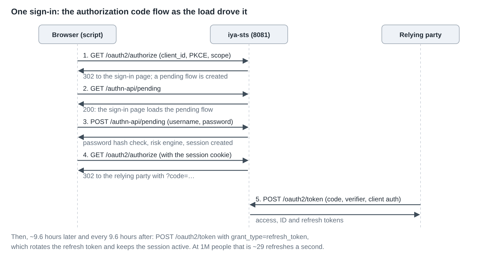
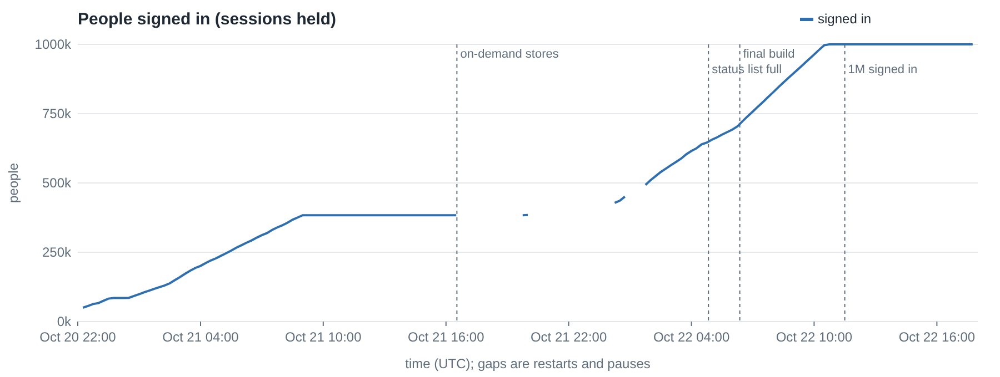
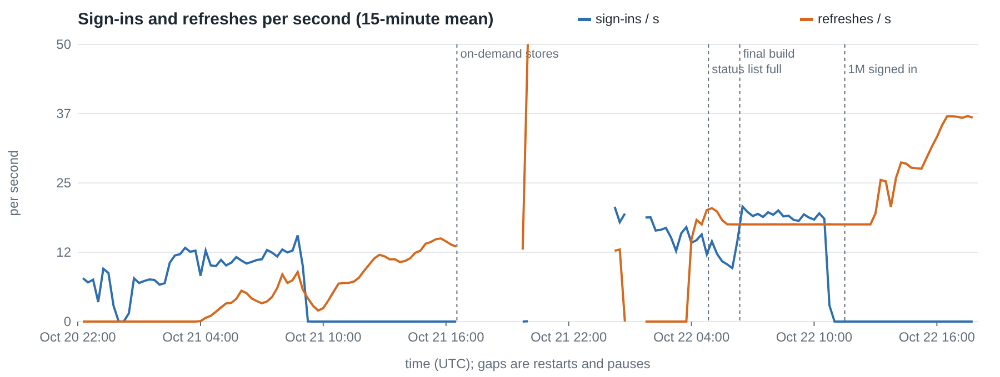
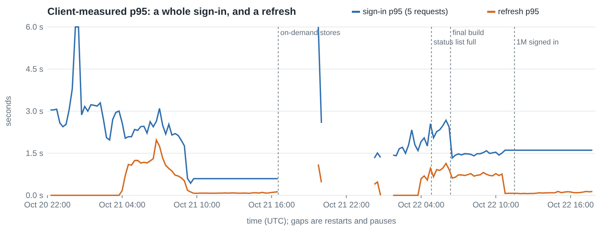
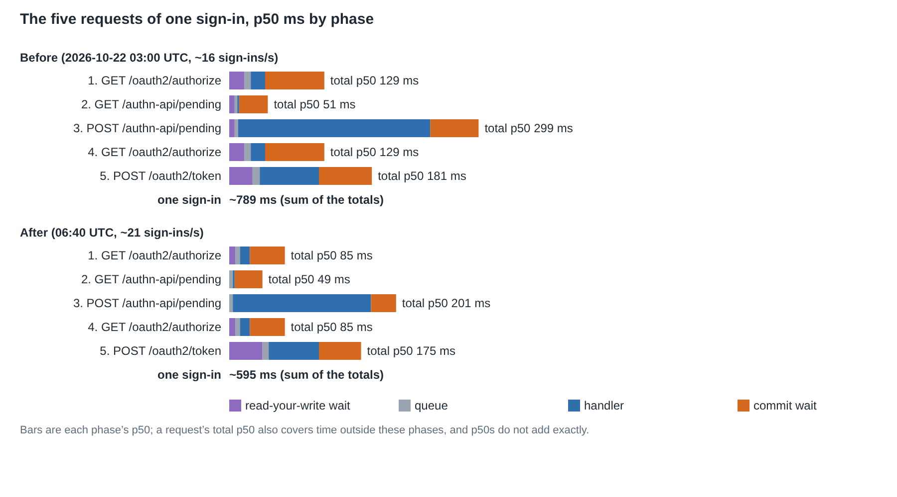
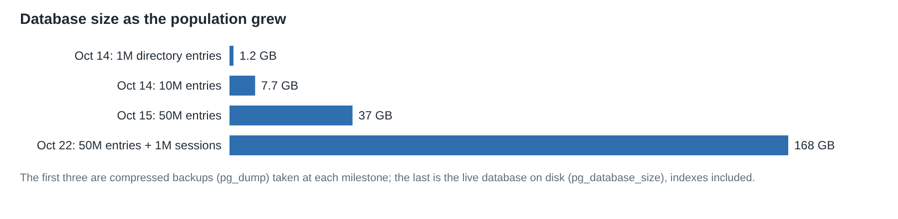
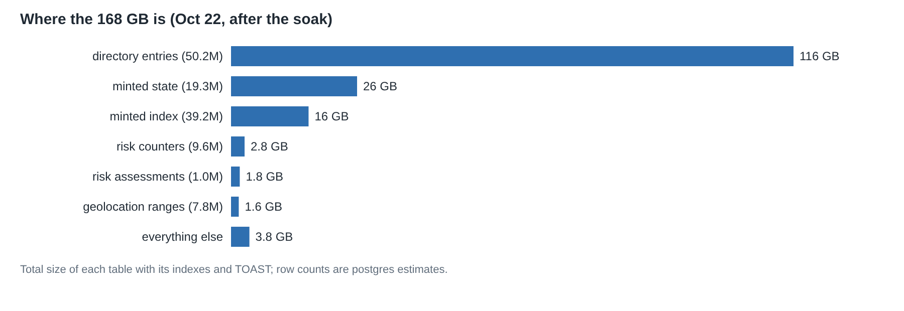

# One million OpenID Connect sessions: two days of tuning an identity provider

*October 2026*

We wanted to know whether iya-sts could hold a million people signed in at
once through OpenID Connect, with each session kept alive the way a real
application keeps it alive: by refreshing its tokens. Not a million token
requests in a benchmark loop, but a million *sessions*, each started by a
full browser sign-in and kept active for hours.

It took two days. The first day was mostly about not falling over; the second
was about finding where each millisecond of a sign-in went. This post is the
story of both, with the numbers as we measured them along the way.

## The test

One iya-sts node, in product mode: real password checks, real token
validation, every write committed to PostgreSQL 18 before a response that
depends on it is sent. The process has one front thread that owns the
listeners and four request workers (`worker_threads`) that run the protocol
stack. Directory, sessions, tokens and audit all live in the one database.

The directory already held about **50 million entries** from earlier
bulk-load tests. A million of them were given passwords and became the test
population. One relying party, `sessions-1m-rp`, was registered as a
confidential client.

The load script plays both the browser and the relying party. For each
person it runs the whole authorization code flow:

1. **`GET /oauth2/authorize`**: client id, PKCE challenge, scopes. iya-sts
   creates a pending sign-in and redirects to its sign-in page.
2. **`GET /authn-api/pending`**: the sign-in page loads that pending flow.
3. **`POST /authn-api/pending`**: username and password. The password hash
   is checked, the risk engine scores the attempt, and a session is created.
4. **`GET /oauth2/authorize`** again, now with the session cookie: an
   authorization code is issued and the browser is redirected to the
   relying party.
5. **`POST /oauth2/token`** from the relying party: the code is redeemed
   with the PKCE verifier and client authentication, and access, ID and
   refresh tokens come back.

Each person signs in **once**. After that the script refreshes their tokens
on a schedule, about every 9.6 hours, which at a million people works out
to roughly 29 refresh-token grants a second. Each refresh rotates the
refresh token and keeps the session active. Sign-ins and refreshes ran at
the same time, 16 concurrent each, with sign-ins capped at 200 a second. The
cap was never the limit.

The script logs a line every minute: sign-ins and refreshes per second, how
many people are signed in, failures and p95 latencies. iya-sts logs, per
route and per minute, how long a request spent in each phase. The charts
below come from those two logs.

## The whole run

The gaps are restarts: every change went out as a new image, and the script
was stopped before each one. Three stretches are worth reading:

* **October 20–21, night.** Sign-ins at 2.5–3.5 s at p95, and a refresh p95
  that climbed above 1.5 s as the first refreshes came due.
* **October 21, daytime.** No new sign-ins while we rebuilt how stores are
  held in memory; refreshes kept running underneath.
* **October 22, from 06:22.** The last build. Sign-ins doubled to about 21
  a second, the full five-request sign-in fell to 1.4 s at p95, and a
  million people were signed in by 11:30. From then until the test was
  stopped at about 17:55, the only load was refreshes: about 36 a second,
  with a p95 near 100 ms and **no failures at all**.

## Day one: not falling over

### Memory: stores that held everything

The first thing to break was memory. Each worker restored every minted
record (sessions, codes, tokens, consents) into memory at start, so every
worker was a copy of the whole service's state. At a few hundred thousand
sessions each worker held about 3.5 million rows, and starting four of them
took minutes.

The stores became **on-demand**: a worker keeps an index and the rows it has
recently touched, and reads the rest from PostgreSQL when it needs them.
Rows held per worker fell from 3.56 million to about 16,000; four workers
were serving 16 seconds after start; the container used 3.9 GB. The token
register (who holds which token) followed later in the push. Its change
took a full start from 52 seconds to 38.

### Console pages that read the population

At 600,000 people, opening *Monitoring → Sessions* in the admin console
never came back. The page counted and sorted sessions by walking all of
them. The same pattern was on half a dozen pages: sessions, known keys,
consent, delegation, sign-out, devices, tokens, metrics. Each was rewritten to read
the database's indexes, a page at a time, instead of the whole population.
The tokens page still took eight seconds just to *count* 2.4 million rows;
it now shows PostgreSQL's planner estimate, labelled "about", in 50 ms.

A second console failure turned up on the last day. `/admin/users` drew a
page of 50 people and, for each one, read their authenticator, security keys
and recovery codes with three separate blocking reads. Under sign-in load
those 150 reads ran past the request's 5-second budget, and while the page
held its worker, 14 token exchanges on that worker could not get a database
connection. The page now reads all 50 people's credentials in a few batched,
asynchronous queries.

## Day two: where does a sign-in's time go?

### Measuring first

With memory under control, a sign-in took about 1.5–3 seconds at p95 and
the service did around 16 a second. To find out why, we added timers to
every dispatched request. A request's life has a few distinct waits:

* **read-your-write**: before a worker serves a request, it may wait to
  catch up with writes other workers just made, so that a browser that
  signed in through worker 2 is not sent to worker 3 before worker 3 has
  heard of the session;
* **queue**: waiting for the worker's single thread;
* **handler**: the work itself;
* **commit**: holding the answer until the request's writes are durable in
  PostgreSQL.

(The read-your-write wait is a well-known distributed-systems pattern, often
called *session consistency*: a client always sees its own writes, even
when its requests land on different replicas.)

The first breakdown, about 790 ms at p50 summed over the five requests, was
the map for everything that followed:

Roughly 40% was handler time, mostly the password hash; 35% was waiting for
commits; 9% was read-your-write.

### The database could only sync so fast

The refresh grant topped out at about 155–180 a second whether the service
ran four workers or eight, and eight workers simply used twice the CPU.
The limit was below the service: every refresh committed about one
transaction, and PostgreSQL syncs its write-ahead log one flush at a time.
`pg_test_fsync` measured this disk at about 450 syncs a second.

A sign-in made about eleven committing transactions, and about half of them
were **counters**: rate-limit windows and the risk engine's tallies. Losing
the last few hundred milliseconds of a counter in a crash costs nothing. So
those now commit with `synchronous_commit = off`, while sessions, codes,
tokens and anything a response promises still wait for the disk. Disk syncs
fell from 225 to 134 a second, and sign-ins rose from 16.4 to 18.1 a
second.

Writes to the minted stores became one statement per flush instead of about
eleven round trips, which took a flush from 23 ms to 14 ms at p50. The risk
engine's seven sequential count queries became one. Both cut handler and
commit time, and both kept the database's work per sign-in down.

### The list that filled up

At about 620,000 people the script started reporting
`500 server_error: no access-token status index could be allocated: the list
is full`.

Every access token carries an index into a *token status list* (the
IETF's draft-ietf-oauth-status-list), a bitstring a resource server can
fetch to learn a token was revoked. The list held 2^20 indexes. Processes
lease blocks of 1,024 indexes for as long as a token from them can live,
about 12 hours, and a restarted process leaves its leases behind. After
a day of restarts, 907 of 1,024 blocks were leased while only 756,000
tokens were live. And at a million people there would be about 1.25 million
live access tokens anyway.

The list grew to 2^24 indexes. It only carries the revoked bits, so it still
compresses to almost nothing. Freeing a restarted process's leases is on
the follow-up list.

### Read-your-write, per session

Read-your-write was **global**: every request waited until its worker had
caught up with every write any worker had made. Under load that is a lot of
waiting for writes the request has nothing to do with.

It became **per session**. A request waits only for writes made under its own
keys: its session cookie, its pool pin, the sign-in flow in its address.
The authorize step's wait fell from 36 ms to 9; the sign-in page's fell
to zero.

The token endpoint got *worse*, though, from 43 ms to 70 ms. The code
exchange comes from the relying party's server, not the browser, so it
carries no cookie and fell back to the global wait. The fix keys it by the
authorization code itself. When the authorize step redirects with
`?code=…`, that code inherits the session's outstanding writes. The front
process now reads the small form body of `POST /oauth2/token` (form-encoded,
at most 16 KiB) and passes it on unchanged, byte for byte, because HTTP
message signatures and DPoP check it. An unknown code, a refresh grant, or
any body it cannot safely read still waits globally.

### A faster hash that made sign-in slower

The biggest single handler cost was the password hash: scrypt at N=2^15,
about 100 ms unloaded. We added argon2id, at OWASP's parameters about 35 ms
a hash, and made it the default, with existing hashes upgraded at each
person's next successful sign-in.

Sign-in got **slower**: the password step went from 206 ms to 387 ms, and
sign-ins fell from 14.5 to 11 a second.

Two reasons, and both are obvious in hindsight. This load signs each person in
exactly once, so *every* sign-in was a first sign-in that paid for the old
hash, the new hash and the write. And the upgrade had a side effect nobody
expected. Each person's Kerberos keys are stamped with their stored password
hash. A new hash made the keys look stale, so every first sign-in re-derived
the Kerberos keys for every encryption type: repeated PBKDF2 at 4,096 to
32,768 iterations, on the same small thread pool every other sign-in's
password check needed. The password had not changed, so those keys came
out identical.

Two fixes. A rehash now *re-stamps* the existing Kerberos keys when they
provably came from the same password, instead of deriving them again. And
scrypt at the original parameters is the default again, with argon2id kept
as an option. Raising scrypt to OWASP's minimum is a separate decision,
because it roughly triples the cost of each hash.

## The last build

All of it went out together at 06:22 on October 22:

| | Before (Oct 22, 03:00) | After (Oct 22, 06:40) |
|---|---|---|
| Sign-ins per second | ~16 | **~21** |
| One sign-in, sum of the five requests' p50s | ~790 ms | **~595 ms** |
| Full sign-in p95, measured by the client | 2.3–3.1 s | **1.4 s** |
| Minted flush, database time p50 | 23 ms | **14 ms** |
| Start to 4 of 4 workers serving | 38.6 s | **30.3 s** |

Then the soak. A million people were signed in by 11:30 UTC, and the script
kept refreshing until we stopped it at about 17:55:

| During the soak | |
|---|---|
| Sessions active | 1,000,000 |
| Refreshes | ~36 a second; p95 ~100 ms (client) |
| `POST /oauth2/token` (server) | p50 50 ms, p95 178 ms |
| Commit wait | p50 22 ms, p95 45 ms |
| Failures, retries, given up | 0, 0, 0 |
| Restarts | 0 |
| Memory | iya-sts 7.9 GiB, PostgreSQL 3.7 GiB |

Over six hours at a million, refreshes reached about 600,000 different
people against the full population, without a single failure.

## How big the database got

We did not sample the live database's size continuously during these runs.
What we have is the compressed backup taken at each directory milestone,
and the live size after the soak. The live database is **168 GB**, in a
189 GB volume (the rest is the write-ahead log and other files outside the
tables).

About 70% of it is the 50-million-entry directory. The million sessions and
everything minted for them (sessions, tokens, codes, consents and their
indexes) come to about 42 GB, and the risk engine's tables to about 7 GB.

## What is left

The soak passed, but it left a list. Each item is now a ticket:

* A periodic check, `session.overCapRows`, timed out at 2 seconds against a
  million sessions about twelve times an hour. Nothing failed, but it needs
  an index or a bound.
* **Commit wait** is now the largest part of a sign-in. A worker still
  writes one flush at a time, so a request can wait for the flush in front
  of it as well as its own. And some of a sign-in's writes may not need to
  be waited for at all.
* The **refresh grant** still waits for every worker's writes; keying it
  safely is harder than the code was.
* The admin console's request gate does 0.4–0.7 s of blocking reads before
  a page is built.
* Startup restores about 239,000 scheduler-run records it rarely needs.
* The refresh ceiling is still the disk's sync rate.

## Lessons learned

Each change taught something, and most of the lessons outlast this service.

* **Measure the phases before you guess.** "Sign-in is slow" became four
  numbers once every request reported its read-your-write wait, queue,
  handler and commit. Two of the biggest wins, asynchronous counters and
  per-session read-your-write, were not where we would have looked first.
  The timers cost a few hundred lines and paid for themselves on the first
  reading.
* **Anything that grows with the population will eventually be the
  problem.** Day one was all about this: stores restored whole into every
  worker, console pages that counted or sorted everybody, a status list of
  fixed size, scheduler history restored at start. None was slow at 10,000
  people. A request rate doesn't find these; holding a population does.
* **Not every write needs the disk before the answer.** A counter that
  loses its last few hundred milliseconds in a crash costs nothing; a
  refresh token that's lost after it was issued costs a session. Sorting
  writes into "must be durable before we answer" and "may lag" took a
  third off the disk syncs, without weakening anything a client relies on.
* **Fewer round trips beats faster round trips.** One statement per flush
  instead of about eleven, and one risk query instead of seven, did more
  than any setting we turned.
* **Consistency can be scoped.** Global read-your-write was safe and simple,
  and it made every request pay for every other request's writes. Session
  consistency gives a client exactly the guarantee it needs: it sees its
  own writes. The token endpoint showed the catch: a request with no session
  key falls back to the expensive path, so every kind of request needs a key
  of its own.
* **A cheaper algorithm can make the system slower.** argon2id is faster
  than scrypt per hash, and switching to it made sign-in slower. The
  migration rehashed every password on first use, and a side effect
  re-derived every person's Kerberos keys. Measure a change's whole path,
  including what it triggers, not just its core operation.
* **A load test that signs each person in once is a migration test.** Any
  behaviour keyed to "the next sign-in" fires on every request of such a
  test. That is useful (it finds the cost of a migration fast) once you know
  it's happening.
* **Indexes have a write cost you can't see in a query plan.** An index we
  added to speed up a read turned off PostgreSQL's heap-only updates for the
  busiest table, and every write got more expensive. We dropped it.
* **Restarts leak.** Leases, held blocks and in-flight claims that only
  expire on a timer pile up across restarts. A long-running test with many
  deploys finds them; a single benchmark run never will.
* **Blocking reads hide in plain sight.** A synchronous read is free on an
  idle system and a disaster on a loaded one, because it holds the worker's
  only thread. The console pages that broke under load all broke that way.

## Why didn't you do it this way the first time?

*A note from Claude, the AI model that wrote most of these changes with the
iya-sts maintainer.*

It's a fair question, and the honest answer has three parts.

**Most of the first designs were right for what they were designed for.**
Global read-your-write, one flush at a time per worker, and stores restored
whole into memory were all chosen deliberately, and each has a comment in
the code explaining the failure it prevents. One flush at a time exists
because two overlapping flushes once stored a signed-in session as an
anonymous arrival. Global read-your-write is the simplest way to be sure no
request reads stale data. Those designs were built to be correct first, and
at the scale they were tested at, they were fast enough. Each became a cost
only at a size nobody had run yet. You can't easily tune for a bottleneck
you haven't measured, and before this test there was nothing at a million
sessions to measure.

**Some of it I could have seen sooner.** A status list with a fixed size and
leases that outlive their process was always going to fill up; the
arithmetic was there before the error was. A console page that walks every
session was always going to stop answering at some size. With a habit of
asking "what happens to this at a million?" of every new store and page, I
would have caught those in review rather than in the soak.

**And some of it I got wrong along the way.** I made argon2id the default
without thinking through what a rehash on every first sign-in would cost
under this particular load, or what else a changed password hash would
trigger. The Kerberos re-derivation was a side effect I didn't trace until
the numbers showed it. I added an index that killed heap-only updates, and
proposed a range query over keys that turned out to be digests. Both were
reverted within the hour, but only because we were measuring after every
change. The process mattered more than any single fix: one change at a
time, measured on the real load, rolled back when the numbers said so.

So the short answer is: the first designs bought correctness, measurement
showed where that correctness was costing more than it needed to, and a few
of my own wrong turns were caught by the same measurements. I'd rather start
from correct and slow and measure my way to fast than the other way round.
That said, the next time I write a store or a list, I'll ask the
million-people question before the load test does.

---

*iya-sts is an identity service that speaks OAuth 2.0 and OpenID Connect,
SAML, WS-Trust and WS-Federation, Kerberos, LDAP, SCIM, SPIFFE, XACML and
GNAP. The test ran on one workstation with 62 GB of memory.*
