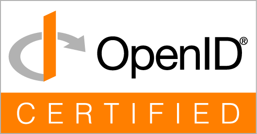

# Certifications

The official compliance certifications iya-sts holds. Each entry names the
body that granted it and links to that body's public registry, where it can
be checked independently.

## OpenID Foundation: OpenID Connect

**Iya-STS v1.0.0**, from Iya CyberSecurity Solutions, has achieved OpenID
Connect Provider (OP) certification through the OpenID Foundation across all
seven published OP conformance profiles and all four OpenID Connect logout
profiles.

### OpenID Connect Provider conformance profiles

| Conformance Profile | Certification Date |
|---|---|
| Basic OpenID Provider | November 5, 2026 |
| Implicit OpenID Provider | November 5, 2026 |
| Hybrid OpenID Provider | November 5, 2026 |
| Configuration | November 5, 2026 |
| Dynamic OpenID Provider | November 5, 2026 |
| Form Post Response Mode | November 5, 2026 |
| Third-Party Initiated Login | November 5, 2026 |

**Official registry:** [Certified OpenID Providers & Profiles](https://openid.net/certification/certified-openid-providers-profiles/)

### OpenID Connect logout profiles

| Logout Profile | Certification Date |
|---|---|
| RP-Initiated Logout | November 5, 2026 |
| Session Management | November 5, 2026 |
| Front-Channel Logout | November 5, 2026 |
| Back-Channel Logout | November 5, 2026 |

**Official registry:** [Certified OpenID Providers for Logout Profiles](https://openid.net/certification/certified-openid-providers-for-logout-profiles/)

### Summary

Iya-STS v1.0.0 has achieved **11 OpenID Foundation certifications**:

- 7 OpenID Connect Provider conformance profiles
- 4 OpenID Connect Logout profiles

All eleven certifications are dated November 5, 2026, and are published in
the OpenID Foundation's official certification registries.

These certifications demonstrate conformance of Iya-STS v1.0.0 with the
applicable OpenID Connect Provider and Logout specifications and profiles.

For independent verification, refer to the official OpenID Foundation
certification registries linked above.

## Related

- [Conformance suites](conformance.md): the suites this service is tested
  against on every run, the OpenID Foundation's among them.
- [Release notes](release-notes.md)
