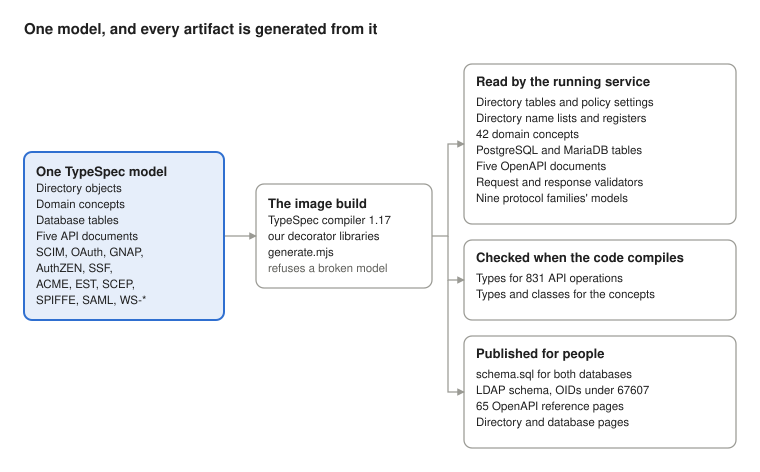

# One model, every artifact

*How the abstract data model came to be, November 2026*

Iya STS now has one model of its data, written in TypeSpec, and every
representation of that data is generated from it: the five OpenAPI
documents, the request validators, the TypeScript types, the PostgreSQL and
MariaDB schemas, the LDAP directory schema, and the wire of sixteen identity
protocols. It took about a week, 75 TypeSpec files and roughly 93,000 lines of
model. It began with a question that should have had a boring answer: what
does this API actually return?

## Where it started: OpenAPI documents with no responses in them

The service publishes five OpenAPI documents: the Management API, the Admin
Console API, the Account API, the Authentication API and the Reports API.
Together they describe more than 800 operations. In early November I went
looking for what one of them returns, and found that the documents described
requests carefully and answers hardly at all.

- The Account API declared a response model on about 4 of its 80 operations.
  The rest answered a bare `{ "type": "object" }`.
- The Authentication API left 15 of 46 operations bare, including the views
  the sign-in screens are drawn from.
- The Management API left about 34 reads bare, and every action answered a
  generic result whose description said it also carried "whatever the action
  produced".
- Every admin model was open (`additionalProperties: true`), and error
  responses were described in prose.

A document like that cannot be a contract. A client generated from it learns
nothing, a reviewer cannot tell an intended member from a leak, and nothing
fails when the code and the document disagree.

The first fix was direct: every operation got a closed response model for
every status it answers, and every JSON response is validated against its
model on the way out, in every mode, with no switch to turn it off. A response
that does not match is not sent. The caller gets a 500 and the operator gets a
log line naming the operation, the status and the member that failed.

That fix exposed the real problem. The response models were a new,
hand-written copy of shapes that already existed in the handlers, in the
TypeScript types, in the directory schema and in the database. Each copy was
maintained on its own, and each had drifted. Writing one more copy was not
going to stay correct. The answer was one model that all of them come from.

## The shape now

Everything on the right is written by one build step from the model on the
left. Nothing on the right is edited by hand.

## Everything the model generates

The model is 75 TypeSpec files under `models/`. One build step compiles them
and writes every artifact below. Most of it is read by the running service,
not just published beside it.

| Artifact | Written from | Read by | How it is held correct |
| --- | --- | --- | --- |
| Directory object tables: applications, roles, devices, service accounts, SPIFFE entries, XACML policies and enforcement points, federation relationships | `models/directory/*.tsp` | The directory, the console and the Management API | Each was byte-identical to the hand-written table it replaced (171,311 bytes for applications) |
| Seven policies' settings: types, defaults, limits, labels, allowed values | The same files (`field` on each attribute) | The policy modules and their console pages | Byte-identical to the tables they replaced |
| The directory's name lists: standard spellings, this service's own names, the attributes withheld from every read | `models/directory/names.tsp` | The LDAP server | A gap report at build time |
| Registers the code branches on: sign-in mechanisms, subject policies, service-account doors | `@entry` facts | Federation, authentication policy, service accounts | A test that reads the source for every id, both ways |
| RFC 4512 LDAP schema definitions, under IANA enterprise number 67607 | Every directory model, plus the RFC texts | Documentation and tests | Against the RFC definitions; no documentation OID may appear |
| 42 domain concepts (User, Group, Application, Session, IssuedToken, AuditEvent, and so on) | `models/domain/*.tsp` | `DomainMap`, which reads directory entries and stored records into them | A test holds each concept to real entries and records |
| PostgreSQL and MariaDB tables and indexes (45 tables), and the owner's `schema.sql` scripts | `models/persistence/*.tsp` | Both database drivers | The same statements as those they replaced |
| Five OpenAPI documents (831 operations), and 65 reference pages | `models/api/*.tsp` | The service serves them | Every response is validated against them |
| Request validators | The same documents | Every API handler, through Ajv or `ModelZod` | A refusal and its document are one declaration |
| TypeScript types for every operation's body, query and answer | The same documents | The handlers' type annotations | `tsc` fails when a handler reads a member the model lacks |
| Nine protocol families' requests, answers, vocabularies and error codes | `models/scim`, `oauth`, `gnap`, `authzen`, `ssf`, `enrollment`, `spiffe`, `saml`, `ws` | Each protocol family's reader | 1,779 recorded answers, compared byte for byte |
| Reference pages for the directory and the database | All of the above | People | Regenerated on every change; a test fails on drift |

## The tools, and why these

The requirement was a single definition of each concept's meaning, with the
wire, memory, storage and validation forms derived from it. That is not one
physical schema reused everywhere: an API request, an in-memory object and a
database row have different needs. They are different projections of one
model.

| Tool | What it does here | Why it, and not the alternative |
| --- | --- | --- |
| [TypeSpec](https://typespec.io) compiler 1.17 | The modelling language and its compiler. The model is plain TypeSpec models and properties, annotated with this project's own decorators | It models concepts apart from endpoints, and its decorators are typed and checked. We use only the compiler, not its emitters |
| Our own decorator libraries (`models/lib/*_lib.tsp` and `.mjs`), one per area | Each declares the decorators an area needs (`@attr`, `@entry`, `@endpoint`, `@message`, `@rpc`, ...) and refuses a model that breaks its rules at build time | The stock emitters write OpenAPI and JSON Schema. Nothing stock writes an LDAP schema, a policy's settings, a SAML vocabulary or a gRPC refusal table, and a switch had to reproduce the old table byte for byte |
| `models/tools/generate.mjs` | Compiles `models/main.tsp` once and writes every generated file | One entry point means one model in one compile, so a type shared between areas is one type |
| [Zod](https://zod.dev) 4, through `ModelZod` | Request validators built from the OpenAPI documents at load time | The refusal a caller gets and the document they read are the same declaration |
| [Ajv](https://ajv.js.org) 8 | Validates every request body on the Management API, and every JSON response on all five APIs | A complete JSON Schema validator for the documents the service already serves |
| TypeScript 7 | Generated `.d.ts` types that the handlers are written against | A handler that reads a member the model does not declare no longer compiles |
| The image build | The only place generation runs; nothing generated is written to a checkout | A service that starts without its generated files refuses and says why, so a stale file cannot be shipped |

We also looked at making the database schema the source of truth through an
ORM and its schema-to-validator generators. We decided against it. A database
row is the wrong master for an API contract: clients must not be able to set
internal identifiers or persistence fields just because a column exists. The
directory is not a relational database either, and most of this service's
data lives there.

## How it migrated without changing the wire

An identity provider's endpoints are specifications other people's software
depends on, so the rule was that a switch to the model changes nothing a
client sees. Every switch followed the same four steps.

1. **Record first.** Before any code changed, the existing behaviour was
   written down. A directory table was saved as JSON. A protocol family was
   recorded as a scripted conversation with every endpoint: its success, and
   every refusal, in each mode that changes a refusal (development, RFC 9700,
   OAuth 2.1 and FAPI 2.0 for OAuth). Random values were replaced by numbered
   placeholders, so two runs of the same code record the same bytes.
2. **Write the model**, by hand, with the comments and the reasoning that sat
   on the old tables.
3. **Generate, and compare.** The generated table had to be byte-identical to
   the old one, and the protocol's answers had to match the recording byte for
   byte.
4. **Only then delete the original**, and point the code at what the model
   generates.

The order mattered. The directory went first, one object at a time, then the
database, then the five OpenAPI documents. Then the gaps a review found: types
nobody used, concepts nobody read, validators still written by hand. Last came
the protocols, in this order: SCIM, OAuth 2.0 and OpenID Connect, GNAP,
AuthZEN, Shared Signals, ACME with EST and SCEP, SPIFFE, then SAML and
WS-Trust with WS-Federation. SCIM went first because it is the smallest and
set the pattern the others copied.

For SAML and WS-\*, the model does not try to be a JSON Schema of XML. It
states facts: the vocabularies, the messages the service reads and in what
order it writes their parts, and which parts must sit inside a signed body.
WS-Trust reuses SAML's vocabularies by reference, not by copy.

Where a recorded answer did not match its model, the mismatch was logged under
a new error code, and the answer was still sent unchanged. The model describes
the wire. It does not get to reshape it silently; each place where it should
was turned into an explicit decision instead (below).

## What had to change in the code

Most of the work was deleting things, and making sure what replaced them said
exactly the same.

- **Tables became generated files.** Every directory object's attribute table,
  every policy's settings and every database table was a literal in a module.
  Each literal is gone; the module asks `ModelTables` for what the build
  generated.
- **Generation moved into the image build, and only there.** Nothing generated
  is written to a developer's checkout. A service started without its generated
  files refuses to start and names what is missing, so a stale copy cannot
  ship.
- **Handlers are typed by the model.** Every API handler declares the operation
  it serves, and its request and answer types come from the generated
  `Operations` interface for that API. Reading a member the model does not
  declare is a compile error.
- **Reads go through concepts.** Code that picked attributes off a directory
  entry, or fields off a stored session, token or audit row, now reads them
  through the domain concept (`DomainMap.fromEntry`, `fromRecord`, `fieldOf`).
  The stored formats did not change.
- **Hand-written validators were deleted.** Request checks are built from the
  OpenAPI documents (`ModelZod.body`, `ModelZod.query`). Validators for
  server-drawn pages that no longer exist went with their error codes, which
  are retired, never reused.
- **Second copies got one source.** Where the same list lived in the model and
  in code (certificate profiles, password doors, sign-in mechanisms), one
  became the source and the other is generated from it.
- **Each protocol family got a reader.** SCIM, OAuth, GNAP, AuthZEN, SSF, the
  enrollment protocols, SPIFFE, SAML and WS-\* each read their requests,
  vocabularies and error codes from their generated model and hold their
  answers to it. SAML and WS-\* share one XML reader.
- **The directory's identifiers became real.** This service's own LDAP
  attributes and object classes had OIDs under RFC 5612's documentation number
  as a placeholder. They now sit under Iya CyberSecurity Solutions' IANA
  Private Enterprise Number, 67607.

## What it found

Writing a model down forces every assumption to be stated, and stating them
turned up real inconsistencies. Some were cosmetic. Several were behaviour,
and each of those was fixed as a deliberate decision, not as a side effect of
the switch.

| Area | What was inconsistent | What it does now |
| --- | --- | --- |
| The four published APIs | Most answers had no model, or an open one | Every answer has a closed model and is validated before it is sent |
| SAML 2.0 | `ForceAuthn="1"` and `IsPassive="1"` read as false. XML Schema's boolean allows `1` | `1` and `0` are read as XML Schema says, in SAML and in WS-Trust |
| WS-Trust | `Forwardable` and `Delegatable` were read from anywhere in a signed request, so an unsigned copy in a header could ask for a forwardable or delegated Kerberos ticket | Both must be inside the signed body, like every other part of the request |
| WS-Trust | `<Delegatable>1</Delegatable>` read as false, and `<Forwardable>0</Forwardable>` as true | Read as XML Schema booleans |
| OAuth dynamic registration | A member of the wrong JSON type (`grant_types` as a string, `client_name` as a number) was accepted | Refused with `invalid_client_metadata`, as RFC 7591 says |
| Reports API | A saved report's parameter names were limited to 64 characters; a run's were not limited at all, and a filter could name a parameter no run could supply | One limit, 1 to 64 characters, stated in the model for both |
| Reports API | The only OpenAPI 3.0 document of the five, so it could not state that limit; its operations had no `operationId` | OpenAPI 3.1, and every operation has an id |
| Issued tokens | A token with no `client_id` and several audiences stored the whole audience array as its client, which the sign-out page then showed as "no client" | The first audience is stored as the client |
| Management API | Actions read old member names the API could never send, and the acting user was injected into the request body | Actions read only declared members; the acting user is passed as an argument |
| Directory | Two AuthZEN attributes on people, and three on groups, were written and read but declared nowhere | Declared, with identifiers |
| Directory | 287 attributes did not say whether they hold one value or several, and 74 had no description | Every attribute states both; a test fails on one that does not |
| Directory | Active Directory's trust attributes were credited to this service, and four SCHAC attributes had no origin | Each cites its standard |
| Duplicated lists | Certificate profiles and password doors existed as a list in code and a frozen copy in the API document | One source, the other generated |
| Identifiers | This service's LDAP OIDs sat under a documentation-only number | Under the registered enterprise number 67607 |

## What is still open

- **Release.** The directory, the database and the five API documents are
  already merged. The protocol families, the identifier move and the fixes in
  the table above are on a branch that merges after the 1.0.0 release.
- **Answers that do not match the model are logged, not refused.** The
  protocol endpoints still send an answer that breaks its model, recording the
  mismatch for the operator. Refusing would make the model the gate, at the
  cost of a failed request for any member the model forgot. That is a
  deliberate choice for now.
- **Two names keep no standard origin, on purpose.** `memberOf` was never
  standardised, and `groupOfURLs` comes from a vendor schema. The model says
  so, instead of pretending otherwise.
- **The end-to-end protocol runs** against running containers, including the
  OpenID conformance suite, still have to pass on the merged result.

## Related

[Abstract data model](data-model.md) · [Directory models](data-model-directory.md) ·
[Persistence models](data-model-persistence.md) · [OpenAPI reference](openapi/) ·
[Error codes](error-codes.md)
