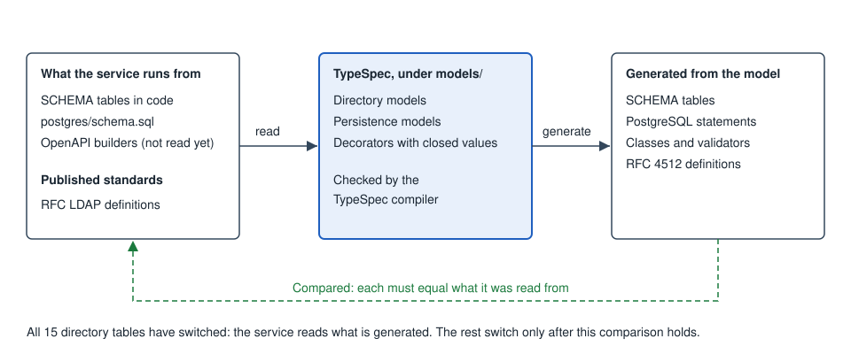

# Abstract data model

The abstract model describes this service's data once, in TypeSpec, under
`models/`, in namespaces that stay apart: a directory entry is not an API
body, and neither is a PostgreSQL row.

**The model is the source.** Every directory object with a published table is
written in it: applications, roles, devices, service accounts, SPIFFE
registrations, XACML policies and enforcement points, federation relationships,
and the seven kinds of policy. The service reads what the image build generates
from it. A policy's settings are there too: their types, defaults, limits, and
labels. So are people, groups, the registers that keep one JSON value, and the
directory's lists of attribute spellings and of the attributes it withholds. The
PostgreSQL and MariaDB tables and indexes are too, and they generate both the
statements the service runs and the scripts an owner runs. So are all five
OpenAPI documents, and so is every protocol family's wire: what each endpoint
of SCIM, OAuth 2.0 and OpenID Connect, GNAP, AuthZEN, Shared Signals, ACME,
EST, SCEP, SPIFFE, SAML, WS-Trust and WS-Federation accepts and answers. Each
object switched only after what the model generated was shown to be the same
as what was there.

*Select the diagram for full size.*

## What is generated from the compiled model

| Output | From compiled TypeSpec | How it is checked | Used by the service |
|---|---|---|---|
| The 15 switched tables, and policy settings | Yes, and TypeSpec is the source | Byte-identical to the tables they replaced | **Yes** |
| RFC 4512 definitions, for names with an OID | Yes | Against the RFC text | No |
| Directory and table classes, with validators | Yes | Compiled and run | No |
| Domain concept classes, and types for every API request and response | Yes | Compiled, and each concept held to real entries and records | **Yes** |
| Request validators for the Account API and Authentication API | Yes, from the documents the service serves | The refusal and the document are one declaration | **Yes** |
| Request validators for the Management API's console actions and the Reports API | Yes, from the same documents | The refusal and the document are one declaration | **Yes** |
| Each protocol family's requests, answers, vocabularies and error codes: SCIM, OAuth 2.0 and OpenID Connect, GNAP, AuthZEN, Shared Signals, ACME, EST and SCEP, SPIFFE, SAML, WS-Trust and WS-Federation | Yes, and TypeSpec is the source | What each endpoint answered before its family switched, recorded and compared answer by answer | **Yes** |
| PostgreSQL tables and indexes, and `postgres/schema.sql` | Yes, and TypeSpec is the source | The same statements as those they replaced | **Yes** |
| MariaDB tables and indexes, and `mariadb/schema.sql` | Yes, and TypeSpec is the source | The same statements as those they replaced | **Yes** |
| All five OpenAPI documents | Yes, and TypeSpec is the source | Equal to the documents they replaced | **Yes** |

## Changing what a directory object holds

The attributes of an application entry are defined in
`models/directory/application.tsp`, and those of every other object with a
published table in that object's file beside it, such as `role.tsp` or
`policy_password.tsp`. To add an attribute, or to change one, edit the file: each attribute is a property with an `@attr` decorator that says how many
values it holds, where it comes from, and what it means. The decorator's keys
are fixed, so a misspelled key stops the build.

The image build compiles the model and generates
one file per object under `models/generated/`, and the service reads those files
when it starts. They exist only inside an image. A tree without them does not
start and says why (`STS-CORE-0093`), and a model that does not compile
fails the build.

The compiler runs in the build and in the tests. It is not in the image that
ships, and neither are the `.tsp` files.

## How an object switches

Each directory object moved to the model the same way:

1. The object's table is written out once as TypeSpec, with its comments.
2. The build generates the table from that TypeSpec.
3. The generated table is compared with the original. It has to be the same.
4. Only then is the original removed, and the TypeSpec becomes the source.

## The models, written out

[Directory models](data-model-directory.md) is every directory model in
reading form: the container, the object classes, and each attribute,
with how many values it holds and where the name comes from.
[Persistence models](data-model-persistence.md) is every PostgreSQL
table in the model, column by column. The API models are under `models/api/`, and the
[OpenAPI reference](openapi/) is their reading form.

The directory and persistence pages are rewritten whenever their
TypeSpec is written. On a checkout that command is
`tests/tools/regenerate-model-docs.sh`. Do not edit the generated
pages by hand.

## Directory

The directory namespace is the domain. An entry in the embedded directory
is where a person, an application, or a policy is stored. The model is the
object: its container, its object classes, and its attributes. The
directory still enforces nothing. No object class is required, and no
attribute syntax is checked when an entry is written. [LDAP schema](ldap-schema.md) is the
explanation of the names. This page does not copy those tables.

An attribute is single-valued, multi-valued, or unspecified when neither
its module nor its RFC says. Provenance is one of `rfc`, `oasis-or-other`,
`iya-sts`, `derived`, or `unspecified`.

An OID, an LDAP syntax, and matching rules are recorded where a published
standard defines the name, read from that standard's text. An object class
also records its kind, its superiors, and its MUST and MAY lists.

This service's own names are numbered in `models/directory/oid_register.json`,
under Iya CyberSecurity Solutions' IANA Private Enterprise Number, 67607. An
attribute type is `1.3.6.1.4.1.67607.1.1.n` and an object class
`1.3.6.1.4.1.67607.1.2.n`. A number is assigned once and never reused.

Each object's container, classes, and attributes are listed on
[Directory models](data-model-directory.md).

A service account is a person-shaped entry under `ou=users`. The
service-account policy is a different object, `policy.serviceAccount`.
Password-policy attributes that live on the person, such as `pwdHistory`,
stay a second list on `policy.password`. They are not copied onto the
policy entry.

People, groups, attribute sources, and the operational attributes have no
SCHEMA module. Their shapes are the catalogue behind
[People](people.md), [LDAP schema](ldap-schema.md), and the group page.
`memberOf` is operational and derived from `member`. An attribute source
is one JSON value, `stsAttributeSourceData`.

The directory does not load a schema when it answers.

The service reads an entry through the concept that names it (see
[Domain concepts](#domain-concepts)), and a stored value that is not in its
type's canonical form reads as absent rather than guessed: a boolean is `TRUE`
or `FALSE` in any case, an integer is digits with an optional leading minus,
and a time is LDAP Generalized Time in UTC (ending `Z`). A value written over LDAP as `12abc` where
a counter belongs is therefore treated as not set.

### What the application's entry states as structure

The `@entry` in `models/directory/application.tsp` names what the attribute
rows do not call out as structure:

* the key, `appIdentifier`
* the derived subject, `urn:sts:application:<appIdentifier>`, which is
  not an attribute
* registration, the declared protocol, and the protocol that was seen
* the relationships to roles, policies, federation, and fine-grained
  authorization
* the application secrets the SCHEMA withholds

A name it uses is a name `common/applications.js` already publishes,
except a derived name, which must not be an attribute.
[Applications](applications.md) is the page for what those fields mean.

## Domain concepts

`models/domain/` says what each thing MEANS, separately from how it is stored. A
concept such as `User`, `Credential`, `Application`, `OAuthClient` or `Session`
names each field and where it is held, and the build refuses a directory
attribute that no concept reads. A credential is its own concept, so passing a
`User` around cannot carry one. Classes for the concepts and types for every
API request and response are generated from the model.

## API

The API namespace is the service's five OpenAPI documents, written as TypeSpec
under `models/api/`. Compiling those files gives each document back, and a test
requires it to equal the one the service serves.

All five have switched: their files under `models/api/` are the source, and the
service serves and validates against what the image build generates. To change an
operation or a schema, edit its file. The [OpenAPI reference](openapi/) is their
reading form.

| Document | What it is |
|---|---|
| Management API OpenAPI document | `/admin-api`, the console's operations for a machine |
| Admin Console API OpenAPI document | the console's own operations |
| Account API OpenAPI document | `/account-api`, the portal |
| Authentication API OpenAPI document | `/authn-api`, the sign-in screens |
| Reports API OpenAPI document | `/report-api` |

## Persistence

The persistence namespace holds the PostgreSQL and MariaDB schemas, one
file per engine under `models/persistence/`, because the two differ in types,
keys, and indexes. Each table is a model and each column carries its SQL type
and clauses. The build generates the statements the service runs and the
script an owner runs from them.

To change a table, edit its model and run
`tests/tools/regenerate-model-docs.sh`, which writes `postgres/schema.sql` and
`mariadb/schema.sql`. Everything else in those scripts is in the templates
beside the models. A column added after a table first shipped is marked in the model, and the
statement giving an existing database that column is generated. Other upgrades,
such as a change of key, are steps between two versions and stay in the driver.

Directory attributes do not become columns. One directory entry is one row
of `sts_ldap_entries`, with the attributes sealed in `attrs`. Four lookup
columns name attributes the SQL already states: `name_keys` is `uid`,
`mail_keys` is `mail`, `uuid_keys` is `entryUUID` and `stsEntryUuidAlias`,
and `class_keys` is `objectClass`.

[PostgreSQL schema](postgres-schema.md) describes the tables.
[Persistence](persistence.md) describes what survives a restart.

## Related

* [Directory](directory.md): a user and an application, and which page configures each.
* [People](people.md) and [Applications](applications.md): the two objects the protocols name.
* [Policies](policies.md): the seven kinds, and how a named policy is chosen.
* [Directory models](data-model-directory.md): every directory model, in reading form.
* [Persistence models](data-model-persistence.md): every table, column by column.
* [LDAP schema](ldap-schema.md): the names, and the containers.
* [PostgreSQL schema](postgres-schema.md): the tables.
* [OpenAPI reference](openapi/): the five documents, as pages.
