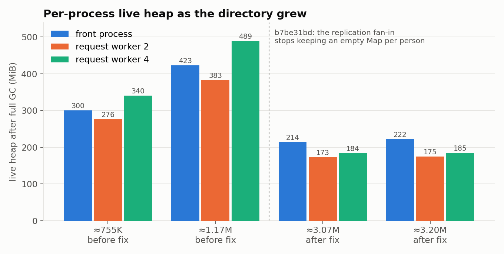
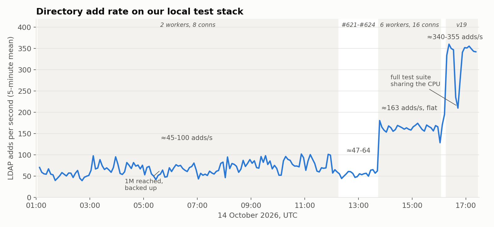

# From 45 to 350 a Second: Scaling the iya-sts Directory Toward 200 Million People

*A day spent loading millions of people into iya-sts's embedded LDAP directory through the service's own front door: what slowed it down, how we measured each problem, and the changes that took sustained user creation from about 45 adds per second to about 350.*

---

iya-sts keeps its people, groups and applications in an embedded LDAP directory. It is served over LDAP and LDAPS, backed by PostgreSQL in product mode, and every attribute that needs protecting is sealed under data keys wrapped by a key-encryption key held in OpenBao. Until this week, the largest directory we had run was a few hundred thousand entries. We want iya-sts to hold **at least 200 million people in one instance**. So on 14 October we started loading people into it and kept going.

The plan was simple: **1M, take a backup, then 10M, 50M and 200M.** The rule we held every change to was just as short. In the words of the ticket that tracks it (#618):

> It is not acceptable that load times grow as the directory grows. The load time should be constant.

In practice that rule meant three things:

- **Constant cost per operation.** An LDAP add, a bind, a search by `uid`, a SCIM create or a token issuance must cost O(1) or O(log n) in the size of the directory.
- **No full scans on a runtime path.** No `count(*)` and no walk of every entry. Instead, use indexed or holder queries, key-cursor pages, and counters that the writes maintain.
- **Asynchronous, non-blocking work.** Where many rows must be read, read them through the asynchronous store path, in pages, and yield to the event loop between pages. A synchronous walk must never run on a request or start-up path.

This post goes through what broke as the directory grew, in roughly the order we hit it. For each problem we give the symptom, how we found the cause, the fix and its ticket, and what it changed. After that come the database work, the throughput story in one chart, the lessons, and what comes next.

---

## The test bed

Everything below was measured on **our local test stack**: a docker-compose deployment of iya-sts, PostgreSQL 18 and OpenBao (which holds the key-encryption key), on a 20-core laptop. The service ran in product mode, so every check was enforced.

The people were created **through the service's own LDAPS interface** by a small loader. The loader binds as an identity holding the Admin Write role and adds `inetOrgPerson` entries under `ou=users`. It used 8 concurrent connections at first and 16 from mid-afternoon. **The system under test is the service, not the loader.** The loader only opens connections and counts.

Alongside the loader, a probe ran every ten minutes and recorded:

- the latency of the public and management endpoints;
- an LDAP `uid` search;
- container memory and CPU;
- the size of the directory table;
- the number of event-loop stalls the service had reported.

When something looked wrong, we went to:

- all-thread CPU profiles of the running processes;
- heap snapshots;
- PostgreSQL's statistics views;
- a replay of the add workload against a scratch copy of the database.

The architecture matters for what follows. iya-sts runs as **one front process that owns every listener, plus a pool of request workers** (`worker_threads`) that run the protocol stack. All of them share one PostgreSQL store. Each worker holds a *window* onto the directory: a bounded cache over the store, not a copy of it. That design is what makes 200M possible at all. It also means that **anything that walks "the directory" in a worker walks the store, one synchronous round trip at a time.**

---

## Part 1: things that walked the whole directory

### The Android attestation recheck froze every listener (#615)

**Symptom.** At about 191K people, every listener (HTTPS, LDAPS and the console) stopped answering for minutes at the top of the hour.

**Found by** a CPU profile of the main thread: 7.7 s of a 10.7 s sample were in the synchronous query bridge. The stack ran from the `devices.android-status-recheck` scheduler job through `persons()` to one synchronous store read per person. **The job read about 191,000 entries one at a time, on the serving front process, to find the one person holding a WebAuthn credential.**

**Fix (#615).** The job now asks the directory's attribute-presence index for the holders only, and only for credentials marked as Android-attested at registration. It reads them asynchronously and in batches, and it skips a realm when nothing has changed since its last run. We also audited every scheduler job for the same shape. A test now fails when a job's code path walks every person, apart from an argued list of exemptions.

### A console page took 45 seconds to show one row (#616)

**Symptom.** At about 200K entries, `GET /admin-api/ldap/directory?per=1` took **38–45 s to return one row**. An LDAP search that the index could not narrow took 28.5 s, and the client timed out. `GET /admin-api/users` took about 3 s to list 5,001 names.

**Found by** profiling with the inspector during the calls. All three paged *every* entry of the realm out of the store, through the synchronous bridge, on a request worker's event loop. Every other request sent to that worker waited behind it.

**Fix (#616).** The fixes were:

- The directory page reads one page by key cursor, and it counts with the store's counters instead of walking.
- An unnarrowed LDAP search streams from the store page by page, asynchronously. It sends entries as they arrive (LDAP allows that) and stops paging at the size or time limit.
- `personNamesUpTo(limit)` reads `limit + 1` names.

A test now fails if any request handler walks a whole windowed realm synchronously. Four request paths still walk and are listed as *owed* in that test: RBAC candidates, cell residents, SCIM lists with other filters, and `/admin/ldap/devices`.

### The credential census and the hourly re-encrypt (#621, #623)

Removing one walk tends to uncover the next.

**The credential census (#621).** At 382K people, a 10.3 s event-loop stall came from `GET /admin-api/users`, which our probe called every ten minutes. #616 had made the list of names asynchronous. But the credential census then read each of up to 5,000 people with its **own synchronous round trip**. The census now reads those people asynchronously in batches, and takes the five attributes it needs from the row.

**The hourly re-encrypt (#623).** The profile also showed every LDAP add asking its uniqueness question through the synchronous bridge. That is constant in cost, but it still blocked the loop for 3–6 s of every 30 s. #621 moved that question onto the asynchronous path as well.

At about 1.5M entries, the hourly `keys.data-key-reencrypt` job kept the front process's main thread 60–70% busy for about 90 seconds. Each run **walked the directory twice to re-seal nothing**: both runs logged `0 value(s) re-sealed`. The job walked and decrypted every directory row whenever any data key was superseded, and a superseded key stays around for seven days. At 200M entries that would have taken about three hours, longer than the hour between runs.

In the same profiles, the scheduler's tick read every row of its run history (about 42K rows) to find the few queued manual runs. That cost 13–19 s of main-thread time.

**Fix (#623, schema v17).** The fixes were:

- The data-key jobs read an indexed `dek_keys` column, plus per-key counts that triggers maintain.
- A pass with nothing to re-seal does nothing.
- The scheduler tick reads queued runs through an index.

### Start-up took half a minute (#617)

**Symptom.** At about 200K entries, the time from container start to the listener binding was **31.7 s**.

**Found by** timing each phase in each process:

- The front process published **279 CRLs into the directory (4 s) before the first worker was forked**.
- The first worker **waited 2 s for its predecessor's origin claim to lapse**.
- Every process restored the same 52,234 minted rows. Of those, 42,740 were the scheduler's run history.
- Building the management API's 566 operations took about 3 s per process.

**Fix (#617):**

- CRLs are published after the listener binds.
- A clean shutdown hands its origin claims back, and a restarted node takes over a claim left by its own previous incarnation.
- Workers skip the scheduler's run history.
- The API's request schemas are compiled lazily.

| When | Directory | Start-up |
|---|---|---|
| Before #617 | ~300K | 31.7 s |
| After #617 | 307K | 12.4 s |
| Later the same day | 380K | 8.3 s |
| Two workers | 2.93M | 10.4 s |
| Six workers, schema v17/v18 | — | 17.5–22 s |
| Six workers, schema v19 | — | 11–12 s |

Start-up time now depends mainly on how many processes there are, not on how many people.

---

## Part 2: costs paid on every add

With the walks gone, the remaining problems were costs that every single add paid.

### Every add rebuilt the group index (#618, phase 1)

**Found by** a rolling all-thread profile at about 214K people and roughly 60 adds/s. Two request workers were 48% and 70% busy. The top frame on the add path was `rolesOf → groupsOfUser → buildGroupIndex`.

The group index was keyed on the directory's version number, and every write moves that number. So the add's own authorization check ("does this binder hold Admin Write?") **rebuilt the group index on every add**. That took 3.7–6.4 s of every 30 s per worker.

**Fix (#618, phase 1).** The group index has its own clock, which only a write that may touch a group moves. In the same phase:

- **Every runtime `count(*)` became a counter row** (schema v16, `sts_ldap_counts`). Statement-level triggers write per-transaction deltas, and a deferred trigger folds them in at commit. A count is now one primary-key read, about 0.03 ms, at any directory size.

### Write tickets that were never announced (#620, #624)

Request workers give read-your-write consistency with *tickets*. A write that has been answered holds a ticket until its worker announces that the write has committed. Until then, reads on other workers wait, for up to 2 s.

**Symptom (#620).** Under the load, `STS-WORKER-0008` fired six times in 40 minutes: a ticket had been answered for more than 30 s and its commit never announced. Until each ticket was dropped, every read paid the full 2 s bound. That is why discovery and JWKS slowed to 0.5–2 s during the load.

**Fix (#620).** A worker now announces an answered write's commit in the same tick as the answer.

**Two more drops (#624).** Both were the same request: a `/healthcheck` that took **about 98 s** from dispatch to answer on a busy worker. Its client (with a 5 s timeout) had long since left, and a response whose client has gone was never announced.

**Fix (#624).** A request whose client has gone is not proxied, and the front process answers `/healthcheck` at once.

### The add asked whether the name was taken twice (#625)

**Symptom.** After the 12:15Z rebuild that brought in #621, the add rate **fell from 64–73/s to about 47/s**.

**Found by** an all-thread profile. Worker 2 was busy 24.3 s of 30.7 s, and 11.9 s of that was a synchronous `byName` query inside the add.

#621 had the add ask its uniqueness question asynchronously *before* the add ran. But it kept that answer only while the `ou=users` container's version had not moved. With several connections adding at once, another add always landed in between. So every add asked the question asynchronously **and then again synchronously**.

**Fix (#625).** An answer is invalidated only by a write that touches *that* DN or *those* names. When several writers exist, uniqueness across processes is still held by the create claims. The same profile showed the outbound SCIM client copying every application on every directory change. It now caches its client list per applications version.

### The cross-worker barrier, and the cost of debug logging (#626, #627)

**The barrier (#626).** A dispatched LDAP operation used to wait on the read-your-write barrier before it ran, which meant a change-log catch-up whenever the other workers were ahead. Under a bulk load from many connections, they always were.

For a write, the barrier was mostly unnecessary:

- the claims already hold uniqueness;
- a key the worker does not hold is read from the store, which is never stale, because a write is answered only after it commits;
- connection affinity keeps one connection's operations in order.

The only real risk was a *held*, possibly stale copy of a key. **Fix (#626).** A dispatched LDAP write re-reads only the windowed keys that other processes wrote, instead of doing the barrier's full pull. Reads keep the barrier.

**Debug logging (#627).** Every function in iya-sts logs its entry and exit at `debug`. The service ran at `info`, yet bunyan's `debug` method still ran and still built its message. That cost 250–480 ms of every 30 s on the front process's per-operation path and on the workers' add path.

**Fix (#627).** `log.debug` and `log.trace` are nearly free while the level is above them, and message construction on the hot paths is guarded. The rule that every function logs its entry and exit stays. Only its cost changed.

### Six workers, and the first big step

With #625 to #627 merged, we restarted the stack with **six request workers instead of two** and raised the loader to 16 connections. The add rate went from about 50–65/s to **153–186/s, flat for hours** (about 163/s on average). It stayed there from 3.0M to 4.4M people added.

---

## Part 3: memory that grew with the directory

### Symptom

Container memory climbed steadily with the directory. With two workers it went from 1.6 GiB at about 200K people to 6.9 GiB at 2.9M. Resident memory is a noisy signal, though: it includes native allocations and fragmentation. So we measured the **live heap after a forced full GC** (`POST /admin-api/node-health/collect-garbage`) in each process:

| Time | People | Front process | Worker 2 | Worker 4 |
|---|---|---|---|---|
| 03:45Z | ~755K | 300 MiB | 276 MiB | 340 MiB |
| 05:26Z | ~1.17M | 423 MiB | 383 MiB | 489 MiB |

That was +379 MiB of *live* heap for about 415K people: about 300 bytes per person in each isolate. It was not a bounded cache filling up. At 10M people it would be about 9 GB, and at 200M it would be impossible.

### Found by

We took **two heap snapshots of one request worker, 21 minutes apart, while the load kept running.** We did not snapshot the front process, because pausing it for long would cost it its cluster membership.

| | Snapshot A | Snapshot B | Δ |
|---|---|---|---|
| `Map` objects | 802,111 | 868,833 | +66,722 |
| fan-in keys for `admin_stats.users` | 798,858 | 864,326 | +65,468 |
| … whose origin Map was **empty** | 796,728 | 861,578 | +64,850 |
| bytes held by that one key map | 208.3 MB | 223.0 MB | +14.7 MB |

That one structure was **51% of the worker's heap and 84% of its growth**, at about 260 bytes per key. The retainer path ran from the scheduler's job table into the replication module's `contributions` map.

The cause was small. When the replication fan-in removed one origin's contribution for a key, it **left that key's now-empty Map behind for ever**. Every process notes every create it replicates in its users register, and then evicts the note once the register is past its cap. So every person ever added left one empty Map in every other process.

### Fix (#618 phase 2, b7be31bd)

A removal now looks up without creating anything, and deletes each level it leaves empty. A new test notes and evicts 30,000 people from three origins with a cap of 100, and asserts that the fan-in never holds more than 100 keys.

| Time | People | Front process | Worker 2 | Worker 4 |
|---|---|---|---|---|
| 13:02Z | ~3.07M | 214 MiB | 173 MiB | 184 MiB |
| 13:36Z | ~3.20M | 222 MiB | 175 MiB | 185 MiB |

The heap is now flat. With six workers, the container stays between about 3.4 and 4.3 GiB from 3M to 6M people.

### Fewer change-log rows per add (#618)

The same investigation explained the change log. Each directory add wrote about **9.4 `sts_changes` rows**. About 4 of those were the users-register notes and evictions above, and about 2.2 were RISC register rows.

Now:

- a replicated create is no longer noted in every process's register;
- the RISC register keeps a row only for an act or a service account;
- a local LDAP add writes 2 minted rows instead of 4, and a replicated create writes 0 instead of 3.

---

## Part 4: the database

At this point the service's own CPU was no longer the limit, so we looked at PostgreSQL. We took two snapshots of the statistics views 300 seconds apart during the load, and sampled `pg_stat_activity` about ten times a second in between. In that window the service was doing **44.9 adds/s**.

### What one add cost the database

| Per add | Measured |
|---|---|
| Committed transactions | 26.4 |
| WAL written | 51 KB (161 records, 4.4 full-page images) |
| WAL fsyncs by client backends | 3.87 |
| `sts_changes` rows inserted | 9.7 |
| `sts_minted` index scans | 33 |

**The disk is the first thing to look at.** `pg_test_fsync` on the laptop's disk measured 136 single 8 kB `fdatasync` calls per second, and about 200 for the fastest method. At 3.87 WAL fsyncs per add and 45 adds/s, that is about 174 fsyncs a second. **The add rate was the disk's sync rate divided by the fsyncs per add.** The wait events agree. On average:

- 1.10 backends were waiting on `LWLock:WALWrite`;
- 0.72 on `IO:WalSync`;
- 0.34 on `Lock:object`, which is the `NOTIFY` queue lock taken at commit.

Three things made it worse:

- **`shared_buffers` was the 128 MB default** against a 9.4 GB database.
- **Every checkpoint was forced** because the WAL filled up. None ran on its timer.
- **GIN pending lists.** The directory's GIN indexes (names, mail, UUIDs, attribute names, classes) used `fastupdate`, so new keys went to an unsorted pending list that every lookup must scan. With pending lists of about 205K tuples, each `byName` probe took **9 ms** and each `byUuid` probe **18 ms**. An add asks `byName` twice. That pending-list scan was **the root cause of the database's CPU.**

### Replaying the add

Changing the live stack to test each idea would have cost hours per experiment. Instead we restored a copy of the database into a scratch PostgreSQL. We wrote the statements of one add, as the service issues them, as a `pgbench` script, and ran variants of it with 8 clients for 60 s each:

| Variant | Adds/s | WAL fsyncs per add |
|---|---|---|
| Baseline: the add as the service did it | 56 | 3.50 |
| `NOTIFY` removed from the transaction | 91 | 1.93 |
| Claims committed asynchronously | 95 | 2.06 |
| Both of the above | **104** | 1.53 |
| + counter rows sharded 16 ways | **326** | 0.53 |
| + `synchronous_commit=off` for everything | **1,015** | 0.05 |
| *Instead of that:* sharded counters, durable commits, 10 adds per transaction | **1,248** | — |

Every row in this table is something we *measured*. Not every row is something we *adopted*.

**`synchronous_commit=off` everywhere** would let a committed add vanish in a crash. A directory that tells a client "your entry exists" and then forgets it is not acceptable. **We did not adopt it.**

**Batching ten adds per transaction** is the bulk-flush item, and it is still open (see *What's next*). In iya-sts each add is answered after its own commit.

**What we did adopt** is narrow. Only the uniqueness-claim statements commit asynchronously. A claim is a short-lived lock that the add's own durable commit releases, so losing one in a crash costs nothing but a retry.

### What landed

**#618, schema v18.**

- The directory's GIN indexes run with `fastupdate=off`, so there is no pending list.
- `class_keys` and `attr_names` no longer index the keys every row shares (`top`, `person`, and attribute names present on 80–100% of rows). That was about 27 useless GIN entries per insert.
- Dead origins are dropped from the fan-in.

**#628, cheaper uniqueness claims.**

- The DN and username claims are one `INSERT … ON CONFLICT` statement, run with `synchronous_commit` off.
- They are released inside the add's own flush transaction, so the entry and the release commit atomically.
- On a single node (no active-active cluster), the front process arbitrates claims in memory over the worker channel, and the database is not involved at all. Where several nodes share the store, the database claims remain.

The cost of releasing claims inside the flush is stated in the ticket. If a flush fails, its claims stay until they expire after 2 minutes, and a retry of the same name inside that window is refused.

**#630, database tuning (schema v19).**

- `NOTIFY` is sent after `COMMIT`, at most one every 25 ms per process. It was always a lossy nudge; the change log is the contract.
- The directory and data-key counters are sharded 16 ways, and readers sum the shards.
- `sts_minted` has a BRIN index on `written_at` and a fillfactor of 80, so its frequent updates can be HOT.
- Autovacuum is tuned per table.
- `pg_stat_statements` and `auto_explain` are on.
- The compose PostgreSQL runs with `shared_buffers`, `max_wal_size` 8 GB, a 15-minute `checkpoint_timeout`, `wal_compression=lz4`, `max_parallel_workers_per_gather=0` (parallel query had tripled the CPU of the batched lookups) and `track_io_timing`.

#630's own before-and-after replay at 200K entries went from 56–61 to 107–138 adds/s, and the lock waits disappeared. **#633** carried the same PostgreSQL settings into the quick-start and test-suite compose files, and added an upgrade step for an existing quick-start volume.

---

## The result

| Configuration | Adds/s |
|---|---|
| 2 request workers, 8 connections, before #625 | ~45–100, most of the time 50–75 |
| 6 workers, 16 connections, after #625–#627 | 153–186, flat for hours (average ~163) |
| Schema v18 (#618's GIN changes), a ten-minute run | ~150–195 (similar) |
| Schema v19 + #628 + #630 PostgreSQL settings | **~335–355** |

The last step more than doubled the rate. It was a database step, and the replay had predicted it: removing the NOTIFY lock, cheap claims and sharded counters were the three rows that took the replay from 56 to 326.

The dip just after 16:35Z is not iya-sts. Another session's full test suite was running on the same laptop, and the load average reached 16 on 20 cores. The add rate fell to about 200–250/s and recovered to about 340/s once the suite stopped.

**Scale reached.**

- **1M** people were added by 05:37Z with **0 failures**. We backed that up: a 1.2 GB `pg_dump` *plus the OpenBao volumes*, because the directory's sealed attributes cannot be opened without the key-encryption key that OpenBao Transit holds. A database backup without its key store restores into a directory that cannot be read.
- By 17:20Z the loader had added **5.7M** people, still with **0 failures**, on its way to 10M at about 20:45Z.
- The database grows by about **2.7 KB per person**.
- The probe's endpoint latencies stayed flat throughout the six-worker phase.

---

## Two bugs found along the way

Neither was a scaling problem. Both were found by the bulk-import work described below, and both are the kind of thing only a large, freshly built directory shows.

- **#631: A windowed first start wrote only 24 of 59 seed rows.** On an empty store, a front process using the directory window (the default) stored the seeded people and CA entries, but not the base DN or `ou=users` and the other containers. Fixed: the first open marks every seeded row as needing to be written.
- **#632: `(uid=VALUE)` matched case-sensitively.** RFC 4519 gives `uid` the `caseIgnoreMatch` equality rule. Searching for `LOAD-x` did not find `load-x`. Fixed: LDAP search matching now follows each attribute's own equality rule. The RFC 4519, 4524 and 2798 case-ignoring attributes (`uid`, `mail`, `cn`, `sn`, `ou`, `dc`, `displayName` and others) match in any case. `memberUid`, the `sts*` attributes and DN-valued attributes stay exact.

---

## Lessons

**Measure before tuning.** Almost every fix above was preceded by a profile, a heap snapshot or a statistics delta that named the frame or the row. We did not guess at the group index rebuild, the empty Maps, or the GIN pending list. Each would have been a long way down a list of guesses.

**Profile the whole process, all threads, under the real load.** A request worker that is 70% busy looks fine from the front process. The all-thread profile is what showed the group index rebuild on every add, the doubled `byName`, and the cost of disabled debug logging.

**A synchronous round trip is a walk waiting to happen.** Each one is cheap. Five thousand of them in a loop freeze a worker for ten seconds, and the loop is usually somewhere you did not expect: a census, a recheck job, a console page.

**Look at live heap after GC, not resident memory.** Resident memory went up, came down on a restart, and went up again, and it settled nothing. Two heap snapshots of the same process at two sizes, diffed by constructor, found the cause in one afternoon.

**A per-person structure that never shrinks is a leak, even when each entry is empty.** An empty `Map` costs about 260 bytes. Times 864K keys, it was half the worker's heap. Any structure keyed by person must either be a bounded cache or delete what it empties.

**Count the fsyncs per add.** At 3.87 WAL fsyncs per add, a disk that does about 175 syncs a second gives you about 45 adds a second, whatever the CPU does. Fewer, cheaper commits per operation mattered more than any single query.

**GIN `fastupdate` trades insert cost for lookup cost, and an insert-heavy load loses.** With pending lists of about 205K tuples, every lookup scanned them. For an index that is read on every write, turn the pending list off.

**Hot counter rows serialise everything.** Exact counts kept by triggers removed `count(*)`, but four hot rows touched by every add became the next lock. Sharding them 16 ways took the replay from 104 to 326 adds/s.

**Know which shortcuts you are measuring.** `synchronous_commit=off` gave 1,015 adds/s in the replay. That is a fact about PostgreSQL, not a design for an identity store. We took it only where losing a row costs nothing: a claim.

**Don't trust a rate printed as an average since restart.** At 17:22Z the loader was printing 315/s, which was its average since it had last been started. The actual rate over the previous five minutes was about 345/s. Every rate in this post is taken from the difference between successive progress lines.

**On a shared machine, the neighbours are in your numbers.** A test suite in another session cut the rate by a third for fifteen minutes. Record the machine's load average with every measurement, or you will "fix" a regression that was never there.

---

## What's next

**10M**, which should complete this evening. Then:

**Bulk import for initial loads (#629, merged, held until after 10M).** An LDAP add is a full protocol round trip with claims, a flush and replication to every process. That is bounded to the hundreds per second. At 350/s, 200M people would take about a week. #629 adds an offline import, a command in the image run against the store while the service is stopped:

- it reads LDIF as a stream;
- it checks every record against the existing directory and against the rest of the file, using the same name rule as an add;
- it seals with the service's own codec;
- it writes each batch with one set-based `INSERT … SELECT FROM unnest(…)`.

The existing triggers keep the counters exact. It does about **3,000–3,300 people/s**. It refuses to start while the service is running, and it re-checks before every batch. It sets no credentials and writes no per-entry audit rows or signals. A re-run skips what is already there. The plan after 10M is: stop the service, import to 50M, restart, measure, and repeat toward **200M**.

**Still open:**

- **#619, start-up and replication:**
  - a change committed between the minted restore's read and the start of replication is never applied in the starting process;
  - scheduler run retention must be bounded by count, not only by age;
  - the default realm's CA row is written back eight times per start;
  - audit events are decrypted into every process at start;
  - the keystore takes 2.0 s in the front process and 1.7 s per worker.
- **Re-sealing after a directory key rotation (#623).** It runs at 500 entries per hourly pass. At 1.5M entries that is about four months, and at 200M about 46 years. A re-seal has to keep pace with the directory: sized by time rather than by count, and run continuously while anything is still under a superseded key.
- **The daily data-key count (#623)** still uses `LIKE` scans that are linear in `sts_minted`, `sts_keys` and `sts_cluster_secrets`.
- **Database items deferred from #630:**
  - batching each flush into multi-row statements;
  - the fence's `FOR SHARE` in every transaction;
  - partitioning `sts_changes` by time.
- **The `audit.nums` row written on every add.**

The rule stays the same at every step: the cost of adding person 200,000,001 should be the cost of adding person 1.

*The tickets named in this post are in the iya-sts repository on GitHub, and the PostgreSQL settings are documented in `postgres/CLAUDE.md` and the compose documentation.*
